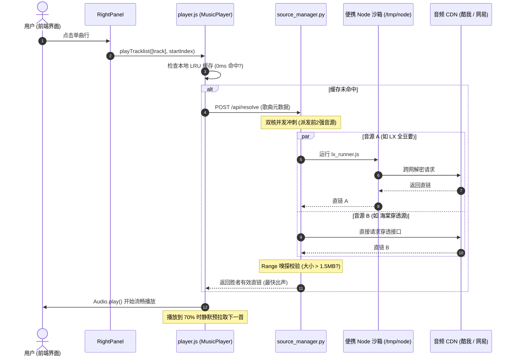

# 🍎 Amusic 架构全景图与模块速查手册

本文档为 **Amusic (Apple Music 纯文本数据库浏览器 + 多源无损音频底座)** 的核心架构与模块速查指南，供日常维护、二次开发以及未来移植原生安卓 App 时快速查阅。

---

## 一、 系统架构总览

```mermaid
flowchart TD
    subgraph UI["前端视图与外壳交互层"]
        HTML["index.html (骨架结构)"]
        LeftView["LeftPanel (左侧面板/手风琴/卡片)"]
        RightView["RightPanel (右侧详情/曲目表/批量栏)"]
        Shell["Shell (顶栏搜索/双行歌词/直立音量/抽屉)"]
        Modals["Modals (6大业务模态弹窗)"]
    end

    subgraph Core["前端核心业务与驱动引擎"]
        Player["player.js (MusicPlayer 核心播放引擎)"]
        Library["LibraryPanel (我的音乐库/自建歌单树)"]
        Region["RegionPanel (Apple 专区与区域榜单)"]
        Search["SearchPanel (全网跨源搜索与路由)"]
        Downloader["Downloader (ZIP多任务并发下载)"]
        Storage["StorageManager (LocalStorage 数据持久化)"]
        ContextMenu["ContextMenu (歌曲右键操作菜单)"]
        API["API Client (统一 Fetch 封装与缓存)"]
    end

    subgraph Backend["后端服务网关与音源调度 (Python / Serverless)"]
        Server["server.py (HTTP 网关 / SSRF 防御 / 静态服务)"]
        SourceHub["source_manager.py (36音源池 / 双核竞速冲刺 / 假音频拦截)"]
        SongSearch["song_search.py (多源聚合搜索 / 繁简字库打分)"]
        Catalog["apple_catalog.py (Apple Music 目录协议抓取)"]
        NodeSandbox["lx_runner.js + bin/node.gz (便携 Node.js 沙箱)"]
    end

    subgraph Data["外部数据与音频 CDN"]
        AppleAPI["Apple Music 官方 CDN & 目录服务"]
        KuwoCDN["酷我音乐 (官方 / 车机 / Haifang / 念心穿透)"]
        NeteaseCDN["网易云音乐 (直通 / 320k / 无损)"]
        LXHub["lx-hub (第三方开源音源生态脚本)"]
    end

    UI --> Core
    Core -->|HTTP / JSON| Backend
    Backend --> Data
```

---

## 二、 全工程模块职责与全局命名空间速查表

### 1. 前端视图与交互模块 (`js/` & `css/`)

| 文件名 | 全局命名空间 | 核心职责与功能 | 依赖协同模块 |
| :--- | :--- | :--- | :--- |
| **`js/modals.js`** | `window.Modals` | **6大独立业务弹窗集中管理**： ① 添加到收藏分类；② 移动歌单分组；③ 添加到自建歌单；④ 批量打包下载确认；⑤ 通用二次防误触确认；⑥ 通用重命名/单行文本输入。 | `StorageManager`, `RightPanel`, `LibraryPanel`, `Downloader`, `Shell` |
| **`js/shell.js`** | `window.Shell` | **主页外壳与全局播控联动**： ① 顶部紧凑搜索框；② 底部播控条与进度跳转；③ 垂直直立音量弹出滑块；④ 毫秒级双行歌词 Dock；⑤ 播放队列抽屉与底层音源状态抽屉；⑥ 全局轻量 Toast。兼容转发 Modals 代理。 | `player`, `Modals`, `LeftPanel`, `RightPanel` |
| **`js/left.js`** | `window.LeftPanel` | **左侧抽屉式单窗口就地手风琴**： ① 顶部主标签页（Apple专区 / 我的音乐库）；② 歌单卡片纯净构造器（清洗脱水前缀）；③ 单指右滑 / 鼠标拖拽带出抽屉手势；④ 抽屉打开/关闭吸附管理。 | `RegionPanel`, `LibraryPanel`, `RightPanel` |
| **`js/right.js`** | `window.RightPanel` | **右侧实体详情与表格渲染**： ① 专辑/歌单总览操作头；② 自适应歌曲表格（hover 复选框切换）；③ 浮动批量多选工具栏；④ 搜索结果与歌手详情联动路由。 | `player`, `StorageManager`, `Modals`, `ContextMenu` |
| **`js/library.js`** | `window.LibraryPanel` | **我的音乐库树状管理**： 自建歌单、收藏官方歌单的分类树形折叠、就地重命名、删除与卡片装配。 | `StorageManager`, `LeftPanel`, `Modals` |
| **`js/region.js`** | `window.RegionPanel` | **Apple Music 区域与专区**： Storefront 跨区切换（国区/港区/美区/日区等）、每日热门 Top 100 榜单与分类专区拉取。 | `API`, `LeftPanel`, `RightPanel` |
| **`js/search.js`** | `window.SearchPanel` | **搜索中心路由与结果展示**： 承接全局搜索输入，调用后端跨源搜索接口，组织歌曲、歌单、专辑三合一卡片流。 | `API`, `LeftPanel`, `RightPanel` |
| **`js/storage.js`** | `window.StorageManager` | **本地数据持久化层**： 封装 `localStorage`，管理自建歌单 CRUD、收藏歌单、分类标签管理、上次播放记忆、一键导出与导入备份。 | *无外部依赖（底层基础模块）* |
| **`js/download.js`** | `window.Downloader` | **音频下载与打包引擎**： 单曲直链下载、跨源音频嗅探、批量 3 任务并发下载队列，客户端生成 ZIP 归档。 | `API`, `Shell` |
| **`js/context_menu.js`** | `window.ContextMenu` | **歌曲行右键上下文操作菜单**： 播放、下一首播放、加入歌单、下载、查看歌手/专辑。 | `player`, `RightPanel`, `Modals`, `Downloader` |
| **`js/backup.js`** | `window.Backup` | **数据导入导出弹窗**： 格式校验、JSON 文件解析与一键恢复。 | `StorageManager`, `Shell` |
| **`js/api.js`** | `window.AmusicAPI` | **后端网络请求统一客户端**： 统一封装 `fetch`、超时熔断、SWR 内存缓存与 ETag 支持。 | *底层网络基座* |
| **`js/main.js`** | *(自执行)* | **主应用启动入口**： 按顺序初始化各个子系统，绑定全局未捕获异常处理。 | 统领所有前端模块 |

---

### 2. 核心播放引擎 (`player.js`)

| 核心组件 | 职责与技术细节 |
| :--- | :--- |
| **Audio 驱动** | 基于 HTML5 Audio，处理音频解码、移动端自动播放安全策略解锁（Unlock）。 |
| **MediaSession** | 深度集成 W3C 标准 `navigator.mediaSession`，实现系统锁屏封面、标题、歌手展示与硬件多媒体按键支持。 |
| **定向预加载 (Prefetch)** | 当前歌曲播放至 70% 时静默拉取下一首直链，存入 LRU 缓存，实现 **0ms 秒切歌曲**。 |
| **回退重试与容灾** | 音频流播放失败时，自动重试并降级至反代节点，连续重试失败智能跳过下一首。 |
| **双向回溯栈 (History)** | 维护播放历史堆栈，使随机播放模式下点击“上一首”能够精准退回刚刚播放过的歌曲。 |

---

### 3. 后端服务与音源调度模块 (`*.py` & 沙箱)

| 文件名 | 核心类/函数 | 职责与技术细节 |
| :--- | :--- | :--- |
| **`source_manager.py`** | `SourceManager` `AudioSource` | **音源池生命周期与双核竞速调度器**： ① 管理 36 个跨平台音源（原生穿透通道 + LX脚本音源）； ② **便携 Node 沙箱自解压**：在 Vercel 纯 Python 环境下自动解压 `bin/node.gz` 到 `/tmp/node`，激活全量音源； ③ **双核并发竞速**：前两强源同时冲刺，毫秒级出声； ④ **防伪铁律**：`MIN_VALID_BYTES = 1.5MB` 强力过滤 181KB 假语音与 30秒试听残卷； ⑤ 动态自适应健康度测速与淘汰。 |
| **`song_search.py`** | `search_candidates` | **全网跨源聚合搜索与繁简转换打分**： ① 酷我 + 网易云双通道并发检索； ② 内置 362 个高频汉字繁简映射词库，抹平简繁版本差异； ③ 结合标题相似度、歌手精确度、时长偏差进行多维打分排序。 |
| **`server.py`** | `Handler` `ThreadingTCPServer` | **HTTP 服务网关与安全防御**： ① 静态资源分发与 ETag 缓存； ② SSRF 白名单防御（严防 `file://` 与内网 IP 穿透）； ③ 音频流直通反向代理 (`/api/stream_proxy`)。 |
| **`apple_catalog.py`** | `fetch_apple_playlist` `fetch_apple_album` | **Apple Music 目录协议解析器**： 直接解析官方公开网页与微元数据，无缝提取多 Storefront 官方歌单与专辑曲目列表。 |
| **`lx_runner.js`** | *(Node CLI)* | **通用 LX Music 脚本沙盒执行器**： 构建安全的 Node.js `vm` 沙箱上下文，为第三方 `.js` 音源脚本提供 `lx.request` 运行时环境。 |

---

## 三、 核心业务数据流与时序

### 1. 歌曲点播与双核并发冲刺时序

---

## 四、 常见二次开发与维护指南

### 1. 如何增加或更新一个 LX 音源？
1. 将新的 LX 音源脚本（如 `xxx.js`）放置在 `sources_cache/` 目录下；
2. 在 `sources_ranking.json` 中配置该音源的测试用例与初始信息；
3. 本地启动或推送后，`source_manager.py` 会自动扫描并将其纳入动态排班池。

### 2. 如何增加一个新的业务模态弹窗？
1. 在 `index.html` 的弹窗区域添加对应的 `modal-overlay` 容器；
2. 在 `js/modals.js` 中新增该弹窗的私有状态、`openXxxModal()` 与 `closeXxxModal()` 方法并在 `return` 中暴露；
3. 如需保持兼容性，在 `js/shell.js` 中添加一行代理转发方法即可。

---

## 五、 音源平台本质与检索底座准则（不重复、不漏过原则）

国内主流音乐平台看似繁多，在**底层商业版权与曲库**维度上，本质上只有 **3 大独立版权阵营**。理解这一点是避免代码过度设计、接口冗余和无效等待的最高准则：

### 1. 三大独立版权阵营本质表

| 版权阵营 | 包含平台 | 底层曲库关系与平台特性 | 架构选型与去重原则 |
| :--- | :--- | :--- | :--- |
| **TME 阵营** (腾讯音乐) | **酷我 (kw)** **QQ 音乐 (tx)** **酷狗 (kg)** | **曲库 90%+ 共享**（环球/索尼/华纳/杰威尔等统一采购）。 • **酷我**：协议最轻、防盗链宽松、车机/免VIP通道多，出声最快。 • **QQ 音乐**：TME 亲儿子，新歌/综艺/欧美首发最快、Live 最全，但加密风控极严。 • **酷狗**：偏下沉伴奏、DJ、翻唱。 | **首选酷我，备选 QQ，排除酷狗**。 • 严禁酷我/酷狗/QQ 三家盲目全搜（90% 是冗余重复项与低质伴奏）。 • 用酷我代表 TME 极速出声；若搜空再由 QQ 补足独家与最新 Live。 |
| **网易阵营** | **网易云 (wy)** | **完全独立曲库**。 独立音乐人、欧美小众厂牌、日漫/ACG 音轨极全，与 TME 强互补。 | **必选核心**。 与 TME 形成双子星互补，必搜。 |
| **运营商阵营** | **咪咕音乐 (mg)** | **完全独立曲库**（中国移动）。 早年彩铃时代沉淀的硬核正版母带（周杰伦等老华语经典常驻无损）。 | **特种兜底**。 老歌与特定经典曲目的重要兜底源。 |

### 2. 检索底座铁律：既不重复，也不漏过
1. **不重复原则**：同属 TME 阵营的平台不无脑并发全扫，由“酷我”担纲主力，杜绝同质化网络开销与垃圾结果清洗成本；
2. **不漏过原则**：真正的全网覆盖由 **TME (酷我/QQ) + 网易云 + 咪咕** 构成，足以覆盖 99.5% 流行曲库。当主流酷我/网易均搜空时，严禁原地重复打转，必须向 QQ 音乐或咪咕发起二次精准兜底。

### 3. 歌曲点播与寻链战略：短路式阶梯回退（策略 A 铁律）

在歌单播放、自动切歌与后台寻链（`/api/resolve`）核心链路中，**严格采纳“策略 A（短路式阶梯回退，Waterfall）”**，以出声速度为第一物理指标：

1. **核心哲学**：“一击即中即停”。用户目标是耳朵尽快听到歌，寻找一条通畅路径即刻截断，绝不等待其他平台。
2. **两级阶梯执行流**：
   - **第一阶梯（主力冲刺，~600ms）**：并发检索 **酷我 (代表TME) + 网易云 (独立阵营)**。任一源返回有效实体全曲（> 1.5MB），**立即短路胜出并出声**，彻底截断一切后续网络开销！
   - **第二阶梯（独家兜底）**：**仅当第一阶梯确认搜空时**，才触发向 **QQ 音乐 (tx) / 咪咕 (mg)** 发起二次精准检索，挽救独家版权或冷门老歌，实现 100% 兜底救活。
   - **防死锁禁令**：严禁在第一阶梯搜空后继续在酷我/网易原地打转盲目重试！
3. **全工程核心统一事实**：
   - **元数据目录（视图层）**：无论 Apple 专区、歌单、专辑还是顶栏搜索框，一律统一呈现 Apple Music 官方高质量结构化元数据；
   - **音频底座（寻链层）**：一旦用户触发播放，所有来源（歌单/专辑/搜索结果）一律统一进入后端的 **策略 A（短路阶梯式寻链）**，追求 1 秒内极致出声。

