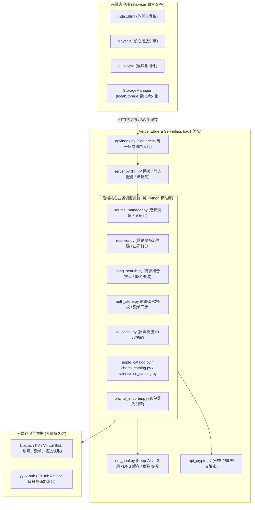
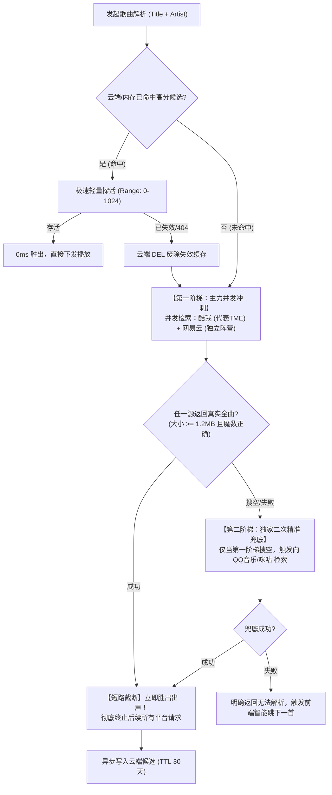

# 🍎 Amusic 工程架构总纲与避坑宪法 (ARCHITECTURE.md)

> **文档定位**：全工程**唯一事实来源（Single Source of Truth）**与对内“宪法级”架构手册。  
> **适用对象**：后续开发者与 AI 编程助手。**在动手修改任何代码前，必须全文精读本手册，严禁违背文中所列铁律。**

---

## 目录
- [一、 物理现实与跨洋网络铁律（防 AI/本地思维乱改指南）](#一-物理现实与跨洋网络铁律防-ai本地思维乱改指南)
- [二、 系统架构全景与模块主权地图](#二-系统架构全景与模块主权地图)
- [三、 核心业务链路与出声防伪准则](#三-核心业务链路与出声防伪准则)
- [四、 认证鉴权与歌单存储架构](#四-认证鉴权与歌单存储架构)
- [五、 专区与特色功能架构规范](#五-专区与特色功能架构规范)
- [六、 基础设施、排班与环境变量清单](#六-基础设施排班与环境变量清单)

---

## 一、 物理现实与跨洋网络铁律（防 AI/本地思维乱改指南）

### 1. 物理拓扑真相（决不能拿着 `localhost` 的思维写代码）

```text
  ┌──────────────────────────────────────────────────────────────┐
  │                      真实世界的物理网络拓扑                     │
  └──────────────────────────────────────────────────────────────┘

   【用户终端】 (中国大陆家庭宽带/移动端 4G/5G)
        │
        │ 跨洋长距离传输 (物理 RTT: 150ms ~ 250ms)
        ▼
   【Vercel 边缘网关 & Serverless 容器】 (美国东部 iad1 节点，境外运行环境)
        │
        ├──▶【国际数据源】: Apple Music 目录、GitHub Actions 密文包
        │
        └──▶【国内音乐 CDN】: 酷我、网易、QQ、咪咕等国内音频节点 (再次跨洋请求国内)
```

1. **服务器在境外，用户在境内**：
   - 本项目线上环境托管于 **Vercel 美东（iad1）Serverless**。
   - 终端用户绝大多数位于 **中国大陆**。
   - 绝大多数音频 CDN 位于 **中国大陆境内**。
2. **本地只是简单开发容器，绝不代表生产环境**：
   - 本地 `127.0.0.1:8000` 调试时，网络请求直接从你本地电脑发出，延迟低且能直连国内 IP；
   - 线上运行时，所有后端逻辑都是在美东机房运行，存在严苛的跨洋延迟、境内防火墙与上游机房 IP 风控！

### 2. 跨洋网络六大红线禁令（违者必造成线上卡死）

1. **【禁令 1】严禁无节制的串行 HTTP 请求（握手爆炸）**：
   - 美东到中国单次 TCP+TLS 握手需 150ms~250ms。串行发起 4 次请求页面就直接卡死 1 秒以上。
   - **执行准则**：所有网络调用必须走 [net_pool.py](file:///home/yytak/gd/MyFiles/project/Amusic/net_pool.py)，强制复用 `urllib3` Keep-Alive 连接池；开启应用层 DNS 缓存与 **IPv4 强制优选**，彻底消除重复握手。
2. **【禁令 2】严禁在 Lambda 中全量下载大音频（内存与超时爆破）**：
   - 音频出声验证的目的是确认“该链接是真音频还是 404/防盗链阻断”，绝非下载整首歌！
   - **执行准则**：嗅探只读前 **1.2MB**（`MIN_VALID_BYTES`），验证格式魔数与音频头通过后**立即切断连接**，将最终音频直链派发给前端直接加载。
3. **【禁令 3】严禁在生产环境把“优雅降级”当成“放行通过”（Fail-Close 铁律）**：
   - 在本地调试时，缺少环境变量允许退守 `.local_auth.json` 且邀请码默认 `1111`；
   - **执行准则**：在 Vercel 生产环境（`is_vercel_env() == True`），若缺少 `AMUSIC_AUTH_SECRET`、邀请码或云存储凭据，**必须直接抛出异常拒绝访问（Fail-Close）**！严禁在线上静默放行未授权注册，严禁尝试写本地只读磁盘！
4. **【禁令 4】严禁在 Serverless 中创建持久后台线程或写文件持久化**：
   - Vercel Serverless 是无状态、请求结束即冻结的沙箱，文件系统除 `/tmp` 外全局只读；
   - **执行准则**：严禁写本地持久文件；严禁运行 `threading.Thread` 做未超时的异步长循环；所有持久状态必须推送到云存储（Upstash KV / Vercel Blob / 客户端 localStorage）。
5. **【禁令 5】严禁引入庞大的三方依赖（冷启动杀手）**：
   - 项目保持 **0 pip 繁重依赖**（仅基础网络连接池 `urllib3`）。彻底废除 Node.js 子进程与外部几十 MB 的运行时二进制，保证冷启动在 50ms 内完成。
6. **【禁令 6】直链优先，反代兜底**：
   - 客户端能直连播放的 CDN 链接优先下发直链，利用国内边缘 CDN 直达用户耳朵；
   - 仅当遇到严格防盗链 Referer 或跨域 CORS 阻断时，才允许走 `/api/stream_proxy` 管道代理。

---

## 二、 系统架构全景与模块主权地图

### 1. 架构拓扑全景图



### 2. 全工程核心文件主权映射表

| 文件路径 | 模块主权与职责 | 修改红线与必须遵守的规范 |
| :--- | :--- | :--- |
| **`server.py`** | 统一 HTTP 请求分发网关、CORS 响应、流代理 | 保持路由轻量，仅做参数校验与分发，严禁把复杂业务解析逻辑堆砌在 Handler 内。 |
| **`api/index.py`** | Vercel Serverless 入口网关桥接 | 负责路径还原（`x-forwarded-uri`），严禁在此处编写具体业务逻辑。 |
| **`resolver.py`** | 歌曲寻链、短路瀑布流（Waterfall）、真实出声检验 | 核心出声中枢。必须遵守“策略 A 短路原则”与打分门禁（>= 80 分方可入库）。 |
| **`source_manager.py`** | 原生音源池、并发冲刺调度、自愈熔断机制 | 纯 Python 实现，零外部进程；音源排班受 `sources_ranking.json` 驱动。 |
| **`song_search.py`** | 多源跨平台歌曲聚合搜索、362个高频繁简词库映射 | 搜索标题与歌手必须做繁简归一化与清洗，过滤伴奏与下架占位符。 |
| **`auth_store.py`** | 邀请码注册、PBKDF2 密码哈希、HMAC 会话签名 Cookie、歌单备份 | 生产环境强制 Fail-Close；歌单写入前严格校验 `<= 512KB` 报文体积上限。 |
| **`kv_cache.py`** | 歌曲出声候选 ID 云端持久化快取 (Upstash REST) | 仅存真实出声合格（>1.2MB）候选，30天 TTL；遇失效必须主动 DEL 自愈。 |
| **`net_pool.py`** | 高性能 `urllib3` 连接池、IPv4 优选、音频魔数嗅探 | 全局底层网络基石。严禁绕过连接池使用生硬的 `urllib.request.urlopen`。 |
| **`public/player.js`** | 浏览器前端音频驱动（HTML5 Audio、MediaSession 锁屏） | 负责 0ms 预加载（70% 进度静默拉取下一首直链）、失败回退重试与双向回溯历史栈。 |
| **`public/js/storage.js`**| 浏览器本地持久化（自建歌单、收藏、分类） | 本地数据的单一事实来源，负责全量导入导出与 2 秒防抖触发云端同步。 |

---

## 三、 核心业务链路与出声防伪准则

### 1. 歌曲寻链战略：短路式阶梯回退（策略 A 铁律）

在歌单播放、自动切歌与后台寻链（`/api/resolve`）核心链路中，**严格采纳“策略 A（短路式阶梯回退，Waterfall）”**，以出声速度为第一物理指标：



1. **核心哲学：“一击即中即停”**：用户的目标是耳朵尽快听到歌，找到一条通畅路径即刻截断，绝不等待其他平台。
2. **两级阶梯执行流**：
   - **第一阶梯（主力冲刺，~600ms）**：并发检索 **酷我 (代表 TME) + 网易云 (独立阵营)**。任一源返回有效实体全曲（> 1.2MB），**立即短路胜出并出声**！
   - **第二阶梯（独家兜底）**：**仅当第一阶梯确认搜空时**，才触发向 **QQ 音乐 (tx) / 咪咕 (mg)** 发起二次精准检索，挽救独家版权或冷门老歌。
   - **防死锁禁令**：严禁在第一阶梯搜空后继续在酷我/网易原地打转盲目重试！

### 2. 找歌四大黄金法则（100% 防翻唱、防串曲、防超时）

| 黄金法则 | 具体实现与防线 | 解决什么严重问题 |
| :--- | :--- | :--- |
| **法则 1：文本脱水与繁简归一** | • 内置系统级 OpenCC（`to_simple()`，0.05ms）+ 362高频词降级词典强制转简体；<br>• 正则剔除 `(Remastered)`、`（Live）`、`[Bonus Track]`、`feat.`。 | 解决港台繁体歌名搜不到、原版多余修饰词导致召回率雪崩的问题。 |
| **法则 2：时长硬门禁 (绝不姑息)** | • 误差 `<= 4秒`：加 10 分；<br>• **误差 `> 15秒`：直接扣 80 分（一票否决淘汰）**！ | **翻唱、伴奏、加长版、DJ版的致命克星**。歌名歌手完全一样的翻唱，唯独时长无法伪装。 |
| **法则 3：版权阵营阶梯短路 (Waterfall)** | • **第一轮（主力冲刺，~600ms）**：并发检索 **酷我 + 网易云**；及格即截断退出；<br>• **第二轮（兜底挽救）**：**仅当第一轮搜空时**，才触发向 **QQ音乐 + 咪咕** 检索。 | 解决向 5 家平台同时盲目广播导致跨洋请求超时被打爆（Vercel 10s 限制）。 |
| **法则 4：小语种/外文歌母语回溯** | 日韩或外文歌曲在国区 Apple 被翻译为英文/中文时，若搜空则调用 `_fetch_apple_native_metadata` 抓取原生母语（如日文原名）二次检索。 | 解决小语种在多语言环境下的元数据错位匹配。 |

### 3. 出声三大物理防伪门禁（宁缺毋滥）

1. **体积硬门禁**：
   - `MIN_VALID_BYTES = 1.2 * 1024 * 1024`（1.2MB）。凡是返回几百 KB 的短试听片段、防盗链警告 HTML，一律视为无效废链。
2. **音频魔数（Magic Number）嗅探**：
   - 首包必须命中标准音频格式特征头：
     - MP3: `b"ID3"` 或帧同步头 `b"\xff\xfb"` / `b"\xff\xf3"`
     - FLAC: `b"fLaC"`
     - M4A / AAC: `b"ftyp"`
3. **假音频黑名单与下架拦截**：
   - 拦截 `81629`、`181521` 字节等已知版权下架语音包（如 `588957081.mp3`），拦截 404 跳转页面。

### 4. 分级置信度与防翻唱抢跑机制

- **分级门禁**：
  - **`score >= 80.0`（高置信度原唱）**：第一梯队主力冲刺，任一胜出立即出声，并允许异步沉淀入 KV 云缓存（TTL 30天）。
  - **`60.0 <= score < 80.0`（低置信度候选）**：严禁与高分原唱并列抢跑！只有当全网高分项（含母语转译与兜底源）全部确认搜空时，才允许在超时余量充足时作为最后救生圈尝试，**且绝对禁止存入云缓存**。
- **真身 ID 铁律**：
  - 搜索层返回的 ID 必须是平台真实的官方实体 ID（纯数字或官方 hex/mid），**绝对禁止在搜索层凭空 MD5 哈希伪造假 ID**。

### 5. 音源工程十二条铁律（防 AI/后续开发者乱改宪法红线）

```text
【找歌与匹配铁律】
1. 【真身 ID 铁律】：搜索返回的平台 ID 必须是平台官方纯正 ID，绝对禁止凭空 md5 伪造假 ID。
2. 【高低分门禁分离】：打分 >= 80 分方为“正版原唱冲刺候选”；60~79 分仅作搜空备选，严禁低分翻唱抢跑截断。
3. 【时长一票否决】：候选音轨时长与目标 Apple 元数据偏差 > 15 秒，强制扣 80 分直接淘汰，绝不姑息翻唱、DJ与截断版。
4. 【多歌手严格对齐】：合作曲目必须拆解为 Token 集合比对，主歌手完全不匹配的一律不得判为及格。

【音源与调度铁律】
5. 【直链优先原则】：音源产出的 URL 必须以“客户端直连可播放”为第一目标，严禁依赖 Serverless 长期中继代理完整音频。
6. 【出声物理三防伪】：必须保留 >= 1.2MB 体积门禁、拦截 81KB/181KB 假语音包、嗅探首包音频魔数（ID3/fLaC/ftyp）。
7. 【单源物理超时上限】：任何音源探针的单个 HTTP 请求超时绝对不得超过 2.5 秒，防止拖死 Lambda。
8. 【总预算递减穿透】：resolver.py 必须严格传递 remaining 剩余预算；只要总余量不足 1.0 秒，立即返回明确结果，绝不触发 Vercel 10s 强杀。

【生产环境与网络铁律】
9. 【全量复用连接池】：严禁在任何地方直接使用未经池化的 urllib.request.urlopen，必须全量走 net_pool.py 的 Keep-Alive 机制并强制 IPv4 优选。
10.【Serverless 零驻留】：严禁在 Lambda 内部开启持久后台线程，严禁执行文件写盘持久化（除 /tmp 外）。
11.【KV 快取自愈准则】：只有 >= 80 分且真实出声的直链 ID 允许入云缓存；一旦缓存出声探活报 404/失效，立即 DEL 抹除自愈并全网回退。
12.【零臃肿依赖】：保持 0 繁重 pip 外部包，严禁引入外部 Node 运行时或笨重二进制，确保冷启动 < 50ms。
```

---

## 四、 认证鉴权与歌单存储架构

### 1. 零依赖安全鉴权模型

- **口令加密**：PBKDF2-HMAC-SHA256 算法，迭代 100,000 次，结合 16 字节随机 Salt 盐，哈希安全不可逆。
- **会话维持**：无状态 HMAC-SHA256 签名 Cookie（`amusic_session`）。服务端通过 `AMUSIC_AUTH_SECRET` 校验合法性与过期时间（默认 30 天），无需在服务端数据库维持 Session 字典。
- **注册防重机制**：依赖存储的原子唯一约束（如 Redis `SET ... NX`）。

### 2. 歌单资产同步与保护原则

- **分级存储原则**：
  - 音量、最后播放进度、SWR 目录缓存、主题配置等高频/临时状态**仅存浏览器本地 `localStorage`**，严禁消耗云端额度。
  - 自建歌单与收藏歌单触发 **2 秒防抖合并上传**，避免用户频繁拖拽/收藏导致请求打爆。
- **体积熔断**：单用户歌单 JSON 严格限制在 **512 KB** 以内，超标直接阻断，防止异常恶意大 JSON 撑爆云端存储。

---

## 五、 专区与特色功能架构规范

### 1. Apple Music 专区 ([apple_catalog.py](file:///home/yytak/gd/MyFiles/project/Amusic/apple_catalog.py))
- 直接解析官方结构化元数据（Storefronts、Top100 榜单、编辑精选）。
- 服务端设置内存缓存（TTL 20 分钟），严格复用 `net_pool.py` 请求头（User-Agent 对齐 Safari）。

### 2. 街声专区 ([streetvoice_catalog.py](file:///home/yytak/gd/MyFiles/project/Amusic/streetvoice_catalog.py))
- **内容矩阵**：
  - **官方排行榜（15 榜 × Top 50）**：即时排行（8 个分类）+ 每周排行（7 个分类），纯 JSON 接口极速抓取；
  - **精选歌单广场**：精选总览（63 个精选）+ 7 大官方主题分区。
- **线路高可用与降级**：
  - 默认使用 **`streetvoice.com`**（海外 Vercel 节点直连极速、提供 **192kbps** HLS 音频流、繁体元数据）；
  - 若 `.com` 请求失败，后端自动静默降级重试 **`streetvoice.cn`**（**96kbps** HLS），并在 `source_name` 中回显标记。
- **音频流与 0 带宽下载闭环**：
  - **绝不走“策略 A 跨源寻链”**：点播携带 `platform: "streetvoice"`，直接播放街声官方原生 HLS 流，避免去外部版权库错误串曲；
  - **客户端纯 JS 脱壳**：利用街声 CDN 开放 `CORS *` 且 `.ts` 分片内封装未加密原生 MP3 帧的物理特性，在浏览器端完成 MPEG-TS 脱壳，单曲与 ZIP 批量下载均直出标准 `.mp3`，**Vercel 服务端 0 带宽消耗**。

### 3. 跨平台全网排行榜 ([charts_catalog.py](file:///home/yytak/gd/MyFiles/project/Amusic/charts_catalog.py))
- **平台覆盖**：聚合企鹅 (QQ)、网易云、酷我、酷狗、咪咕五大平台官方无鉴权 API 榜单。
- **低压长效双层缓存策略**：
  - 榜单目录结构缓存 **24 小时**，曲目列表缓存 **12 小时**，彻底保护上游接口。
- **播放与透传**：
  - 提取标准曲目元数据（`name`, `artist`, `album`, `durationMillis`, `sourcePlatform`, `id`）。直连源优先播放，遇会员独占/下架自动无缝回退至策略 A 瀑布流补全出声。

### 4. 第三方歌单导入与转化引擎 ([playlist_importer.py](file:///home/yytak/gd/MyFiles/project/Amusic/playlist_importer.py))
- **覆盖平台**：
  - 主流无登录全覆盖（9 大平台）：网易云 (`wy`)、QQ 音乐 (`tx`)、酷我 (`kw`)、汽水音乐、咪咕 (`mg`)、酷狗概念版 (`kg`)、Apple Music、街声、Spotify（公开歌单前 100 首）。
- **交互与存储规范**：
  - **搜索框双模分流**：输入普通文本走 Apple 曲库搜索；输入 URL/分享口令/平台短前缀静默分流至解析接口，**直接在右侧详情区预览**（UI 零破坏）。
  - **多跳短链防 SSRF**：每一跳短链重定向（`163cn.tv`, `c6.y.qq.com`, `qishui.douyin.com` 等）均严格执行 SSRF 安全校验与域名白名单。
  - **转存快照**：转存为 `customPlaylists`（自建快照歌单），0ms 本地秒开，不将外部失效链接写入本地，彻底免疫原歌单下架或设为私密。

### 5. 主题自适应配色系统
- **7 套精选主题**：纯 CSS Variables 驱动。
  - `dark`（暗夜黑，默认）、`midnight`（午夜深蓝）、`light`（极简纯白）、`sky`（晴空浅蓝）、`warm`（护眼暖米）、`mint`（薄荷浅绿）、`pink`（樱花浅粉）。
- **Zero-FOUC 防闪烁**：
  - 主题 ID 仅存 `localStorage.getItem('amusic_theme')`，不耗云端配额；
  - `<head>` 顶端以 3 行同步内联脚本预设 `dataset.theme`，彻底消除白屏/黑屏闪烁。

### 6. 前端 SPA 架构与 API 路由全景表
- **前端四大视图分层**：
  - `Shell`：顶栏搜索、地区选择、双行歌词、立式音量、抽屉。
  - `LeftPanel`：网站推荐（Apple 专区 + 街声手风琴 + 平台榜单）与我的音乐库。
  - `RightPanel`：歌单详情、曲目列表、批量复选与操作栏。
  - `PlayerBar` (`player.js`)：HTML5 Audio 底座、0ms 静默预载下一曲（70% 进度探测）、MediaSession 锁屏控制。
- **核心 API 路由索引**：
  - `/api/catalog`：Apple Music 官方目录与市场数据。
  - `/api/charts`：全网排行榜分类与曲目拉取。
  - `/api/streetvoice/*`：街声排行榜、歌单广场与曲目直解。
  - `/api/import_playlist`：外部歌单口令与链接解构。
  - `/api/resolve`：策略 A 阶梯短路寻链与真流检验。
  - `/api/search`：跨源聚合搜索与繁简转换纠偏。
  - `/api/stream_proxy`：跨域防盗链音频直通中继。
  - `/api/lyric`：多源歌词检索与时间轴解析。
  - `/api/auth/*`：邀请码校验、登录注册、歌单云同步。
  - `/api/sources`：底层音源健康度与实时测速排班表。

---

## 六、 基础设施、排班与环境变量清单

### 1. 核心环境变量清单

| 环境变量名 | 作用与级别 | 缺失时的默认行为 |
| :--- | :--- | :--- |
| **`AMUSIC_AUTH_SECRET`** | **[生产必填]** 会话签名核心密钥 | 本地开发使用随机生成密钥；**生产环境缺失则 Fail-Close 拒绝鉴权**。 |
| **`AMUSIC_INVITE_CODES`** | **[生产必填]** 注册邀请码列表 (逗号分隔) | 本地默认 `1111`；**生产环境缺失则关闭新用户注册**。 |
| **`KV_REST_API_URL`**<br>**`KV_REST_API_TOKEN`** | **[核心]** Upstash Redis / Vercel KV 连接凭据 | 本地退守 `.local_auth.json`；生产缺失则账户/歌单同步接口报 500。 |
| **`BLOB_READ_WRITE_TOKEN`**| **[可选]** Vercel Blob 存储凭据 | 当歌单系统切换至 Blob 时必填。 |
| **`AMUSIC_SYNC_KEY`** | **[可选]** 音源密文解密密钥 | 默认内置密码 `yy-lx-hub::amusic::auto-sync-v1`。 |
| **`CRON_SECRET`** | **[运维必填]** 定时任务触发鉴权 Token | 保护备份与自动化巡检接口不被外部盗刷。 |

### 2. 自动化排班与音源更新机制

- 上游仓库 `ichbinyytak/yy-lx-hub` 每日 **04:00 (UTC)** 发布密文包 `extracted_apis.enc`。
- 本仓库 GitHub Actions 每日 **05:00 (UTC)** 触发 [sync_sources.py](file:///home/yytak/gd/MyFiles/project/Amusic/sync_sources.py)，拉取最新密文并在本地完成并发测速，更新 [sources_ranking.json](file:///home/yytak/gd/MyFiles/project/Amusic/sources_ranking.json) 并自动推送到仓库，触发 Vercel 自动化构建。
- `source_manager.py` 在 Serverless 启动时，直接读取 `sources_ranking.json` 即可实现 **0ms 秒级预热**，无需在线测速。

---

> **结语**：Amusic 的第一生命线是**出声速度与稳定性（准而稳）**。任何功能的重构、扩展或优化，都必须在上述物理网络边界与架构铁律下进行。
