# Amusic 站点地图 (Site Map)

> **项目名称**：Amusic (Apple 音乐纯文本数据库浏览器与在线播放器)  
> **服务地址**：`http://127.0.0.1:8088`  
> **更新时间**：2026-11-02  
> **架构设计**：零构建原生 JavaScript (ES6+)、原生 CSS 变量系统、Python 标准库轻量高并发后端

---

## 🗺️ 一、 界面与视觉交互拓扑 (UI Topology)

```mermaid
graph TD
    Root["Amusic 单页中枢 (index.html)"]
    
    %% 顶栏
    TopBar["顶栏操作区 (Header Toolbar)"]
    Root --> TopBar
    TopBar --> SFSelect["🌍 地区切换 (CN / HK / TW / US / JP / GB)"]
    TopBar --> SearchBar["🔍 全局歌曲/专辑搜索栏"]
    TopBar --> SourceBtn["⚡ 音源管理与测速面板"]
    
    %% 左侧导航
    LeftPanel["左侧面板 (Left Navigation Panel)"]
    Root --> LeftPanel
    LeftPanel --> TabNew["🔥 最新发布 (/new)"]
    LeftPanel --> TabExplore["🏷️ 类别探索 (48+ 专区与排行榜)"]
    LeftPanel --> TabLibrary["📁 我的音乐库 (收藏与自建)"]
    
    %% 右侧曲目详情
    RightPanel["右侧面板 (Right Track Detail Panel)"]
    Root --> RightPanel
    RightPanel --> DetailHeader["歌单/专辑标题与编辑信息"]
    RightPanel --> ActionButtons["操作栏 (播放全部 / 收藏 / 复制链接 / 复制文本)"]
    RightPanel --> TrackTable["曲目列表表格 (3列高密度排布)"]
    
    %% 底部播放控制
    PlayerBar["底部常驻播放器 (Player Engine & Controls)"]
    Root --> PlayerBar
    PlayerBar --> TrackInfo["当前歌曲信息与双行实时歌词"]
    PlayerBar --> AudioControl["控制键 (播放/暂停/上一曲/下一曲/进度条/循环模式/音量)"]
    PlayerBar --> QueueDrawer["🎵 播放队列抽屉"]
    PlayerBar --> FullscreenLyric["🎤 全屏沉浸式时间轴歌词"]
```



---

## 🧭 二、 功能页面与导航体系 (Site Navigation & Features)

### 1. 🔥 最新发布 (`/new`)
官方底层 SSR 页面深度提取，所有散装单曲升格为精选歌单，非音乐宣传内容严格过滤：
* **🔥 焦点推荐与主推歌单**：官方重磅主推专辑与精选集
* **新歌精选**：官方精选新歌，支持一键穿透官方 Room 加载 100 首完整合集
* **本周新发行**：最新上架热门专辑
* **新近发布**：各流派最新上线音乐实体
* **歌单已更新**：编辑定期轮换更新的权威歌单
* **周一缓冲带🍵**：治愈放松主题歌单与专辑
* **正在流行中**：实时上升趋势单曲合集
* **大家都在听**：全平台高播放量专辑与精选
* **每周热门 100 首**：涵盖全球主要区域与流派的周榜歌单
* **城市排行榜**：各主要都市地标风向标榜单
* **Apple Music 独家**：平台独占发行与特别企划
* **最新 DJ 混音**：Club 与电子制作人混音辑
* **正在巡演中**：巡演艺人官方现场曲目单
* **即将发布**：未来预售与抢先收听专辑

---

### 2. 🏷️ 类别探索 (`/search` 官方 48+ 音乐专区与排行榜)
全站统一采用**单窗口层级手风琴结构**（就地展开、无页面跳转、无冗余图标、无缩进，红色醒目标题配纯 SVG 箭头与曲目角标）：

| 专区大类 | 包含的官方音乐专区与特色板块 |
| :--- | :--- |
| **华语与东亚流行** | **国语流行**、**粤语流行**、**C-Pop**、**K-Pop**、**J-Pop**、**台湾流行** |
| **欧美与国际主流** | **国际流行 (Pop)**、**嘻哈/说唱 (Hip-Hop/Rap)**、**R&B/魂乐**、**摇滚 (Rock)**、**另类/独立 (Alternative/Indie)**、**乡村 (Country)** |
| **电子与舞台演出** | **舞曲/电子 (Dance/Electronic)**、**最新 DJ 混音**、**正在巡演中**、**Apple Music 独家** |
| **经典与人文艺术** | **经典摇滚**、**重金属 (Metal)**、**爵士乐 (Jazz)**、**古典音乐 (Classical)**、**蓝调 (Blues)**、**民谣与创作人 (Singer/Songwriter)**、**世界音乐** |
| **生活场景与心情** | **放松 (Chill)**、**专注 (Focus)**、**睡觉 (Sleep)**、**工作时间**、**派对 (Party)**、**运动健身 (Fitness)**、**浪漫 (Romance)**、**通勤路上**、**家庭陪伴** |
| **视听与跨界企划** | **原声带与影视配乐 (Soundtracks)**、**动漫游戏 (Anime/Video Game)**、**空间音频 (Spatial Audio)**、**年代热门金曲 (Decades)** |
| **权威榜单合集** | **排行榜 (/new/top-charts)**：<br>• 热门歌曲排行 Top 50（自动聚合单曲榜）<br>• 城市排行榜（各城市热歌单）<br>• 每周热门 100 首合集<br>• 热门歌单排行 50 强<br>• 热门专辑排行 50 强 |

> **专区二级子板块**（点击任意专区后就地展示）：  
> `🌟 焦点推荐` ➔ `歌单` ➔ `热门歌曲/合集` ➔ `最新发行` ➔ `明星曲目单` ➔ `经典专辑` ➔ `年度热门作品`

---

### 3. 📁 我的音乐库 (`/library`)
本地持久化存储系统（基于 `localStorage`，支持全量导入/导出备份）：
* **⭐ 收藏歌单**：
  * 支持自定义分类（未分类、华语流行、车载精选、摇滚等），未分类始终置顶；
  * 分类管理：新建分类、重命名分类、删除分类（歌单自动移回未分类）；
  * 收藏的官方歌单支持一键重命名与移除。
* **🎵 我的歌单（自建歌单）**：
  * 随时创建个性化自建歌单；
  * 支持重命名歌单、删除歌单；
  * 歌单内曲目管理：从任何播放页面点击 `➕` 加歌、歌单内单曲移除、单曲排序。
* **💾 数据备份与恢复**：
  * **导出备份**：一键将所有收藏、自建歌单与曲库配置打包下载为 `JSON` 备份文件；
  * **导入恢复**：一键导入外部备份 JSON，无缝迁移与恢复。

---

### 4. 📄 歌单与专辑详情面板 (Detail Panel)
* **元数据展示**：歌单/专辑名称、策划编辑（Curator/Artist）、曲目总数统计；
* **快捷操作栏**：
  * `▶ 播放全部`：将当前列表所有歌曲装载入播放器并立即开播；
  * `⭐ 收藏`：将当前官方歌单添加至本地音乐库并归类；
  * `🔗 复制链接`：生成标准的 Apple Music 官方 Web 直链；
  * `📋 复制歌曲`：提取纯文本清单（`歌曲名 - 歌手`），方便导入外部工具。
* **曲目表格**：
  * `#` 序号、歌曲标题、歌手、专辑；
  * 单曲操作：时长显示、`➕` 添加到自建歌单；
  * 双击/单击整行立即切歌播放，高亮显示当前播放中的音轨。

---

### 5. 🎛️ 音频播放引擎与控制栏 (Audio Engine)
* **播放控制**：播放/暂停、上一曲、下一曲、循环模式切换（顺序播放 / 单曲循环 / 随机播放）；
* **进度条**：精确时间轴、时间进度拖拽与点击 Seek；
* **音量系统**：音量滑块调节、一键静音与原音量恢复；
* **实时歌词**：
  * 播放栏双行歌词预览（当前句高亮、下一句预读）；
  * 全屏沉浸式歌词面板（支持时间轴精确同步滚动、点击空白关闭）。
* **播放队列**：
  * 抽屉式队列列表，显示歌曲名、歌手与播放中状态；
  * 支持队列内点击插播切歌。

---

### 6. ⚡ 音源管理中心 (Source Manager)
* **36+ 异构音源集群**：整合车机逆向通道、各大平台开放直连、海棠、念心及 32+ lx-hub 解析源；
* **全自动并发探活**：一键测速，测量各音源的真实解析时延（ms）与可用性；
* **自适应奖惩重排**：依据测速与解析成功率自动置顶优质源；
* **单源独立控制**：支持单独开启/禁用指定音源；
* **在线源同步**：支持一键从远程 lx-hub 订阅源拉取最新可用源规则。

---

## 🔌 三、 后端 API 路由地图 (API Routes Sitemap)

后端运行于 [`server.py`](file:///home/yytak/gd/MyFiles/project/Amusic/server.py)（默认端口 `8088`）：

| 接口端点 (Endpoint) | 请求方式 | 参数 | 职责与功能说明 |
| :--- | :---: | :--- | :--- |
| **`/api/apple_new`** | `GET` | `storefront` (默认 `cn`) | 抓取 Apple 官网 `/new` SSR 页面并结构化为 14 大核心音乐板块 |
| **`/api/apple_search_page`** | `GET` | `storefront` (默认 `cn`) | 提取 Apple 官方 48+ 音乐分类专区与排行榜入口 |
| **`/api/apple_curator_page`** | `GET` | `url` (各专区/排行榜 URL) | 深度抓取 Curator 专区主页，提取子板块（焦点、歌单、单曲榜、专辑） |
| **`/api/apple_room`** | `GET` | `url` (官方专题 Room 链接) | 抓取精选专题 Room 的 100 首完整曲目大合集 |
| **`/api/apple/*`** | `GET` | 官方 Apple Catalog 路径 | 高速反向代理 Apple 官方 API（带 Bearer 令牌、支持 304 ETag 缓存协商） |
| **`/api/music/search`** | `GET` | `keyword`, `source` | 调用 [`song_search.py`](file:///home/yytak/gd/MyFiles/project/Amusic/song_search.py) 在各大平台跨源搜索歌曲 |
| **`/api/music/url`** | `GET` | `track_name`, `artist`, `album` | 调用 [`source_manager.py`](file:///home/yytak/gd/MyFiles/project/Amusic/source_manager.py) 与 [`lx_runner.js`](file:///home/yytak/gd/MyFiles/project/Amusic/lx_runner.js) 获取无损/高品质音频直链 |
| **`/api/music/lyric`** | `GET` | `track_name`, `artist` | 获取带毫秒级标准时间轴的 LRC 歌词数据 |
| **`/api/sources`** | `GET` | 无 | 获取当前所有已加载音源列表及其优先级状态 |
| **`/api/sources/test`** | `POST` | `sample_song` | 并发对所有音源进行真机测速与探活打分 |
| **`/api/sources/reorder`** | `POST` | `order: string[]` | 手动或自动保存音源优先排序权重 |
| **`/api/sources/toggle`** | `POST` | `source_id`, `enabled` | 开启或禁用指定音源通道 |
| **`/api/sources/sync`** | `POST` | 无 | 从远端订阅中心同步最新的音源解析配置 |

---

## 📂 四、 代码与资源文件地图 (Repository Structure)

```text
/home/yytak/gd/MyFiles/project/Amusic/
├── index.html                # 核心单页入口（挂载各功能模块与版本戳 v=4.5）
├── server.py                 # HTTP 极速服务器、API 路由派发与静态文件托管
├── apple_catalog.py          # Apple SSR 页面深度抓取器与 Catalog 数据规范化引擎
├── source_manager.py         # 音源调度中枢（36+ 音源竞速、健康检查、奖惩模型）
├── song_search.py            # 跨平台歌曲搜索与精准度加权匹配打分器
├── lx_runner.js              # Node.js lx 音源驱动环境与脚本解释桥接器
├── player.js                 # 核心原生音频播放引擎 (Audio Pipeline, 事件总线)
├── style.css                 # 样式总线引入
├── README.md                 # 项目介绍与快速入门指南
├── SITEMAP.md                # 站点架构与功能拓扑地图（本文件）
├── VERSION_HISTORY.md        # 完整版本迭代演进与历史归档
│
├── css/                      # 模块化样式表
│   ├── base.css              # 全局基础主题、CSS 变量、重置样式与滚动条
│   ├── left.css              # 左侧栏样式（手风琴折叠、卡片布局、分类管理）
│   └── right.css             # 右侧曲目详情、表格、模态窗与歌词浮层样式
│
├── js/                       # 前端核心业务逻辑模块
│   ├── api.js                # API 请求客户端、SWR 缓存协商机制与通用工具库
│   ├── storage.js            # 本地存储管理器（收藏歌单、自建歌单、历史记忆、导入导出）
│   ├── explore.js            # 类别探索面板（48+ 专区与排行榜的单窗口就地展开手风琴）
│   ├── shell.js              # 播放器外观交互（播放条、歌词同步、队列抽屉、音源弹窗）
│   ├── left.js               # 左侧导航中枢（Tab 切换、/new 渲染、音乐库分类管理）
│   ├── right.js              # 右侧曲目详情渲染、歌曲点击点播、曲目收藏与导出
│   └── main.js               # 全局应用入口与模块间事件绑定
│
└── sources_cache/            # 远端音源缓存与用户自定义音源脚本存储目录
```

---

## 🔒 五、 架构与约束规范

1. **绝对独立性**：严格与同级项目 [`YY-music`](file:///home/yytak/gd/MyFiles/project/YY-music) 隔离，任何代码变更仅作用于 `Amusic` 目录。
2. **纯原生与零构建 (Zero-Build)**：前端完全基于标准原生 JavaScript 与 CSS 原生变量，不依赖 Webpack/Vite/Babel；后端仅依赖 Python 3 标准库与 Node.js 运行时。
3. **曲目真实有效性准则**：所有展示在界面上的歌单/专辑/合集均建立多重智能降级（`playlists` ↔ `albums` ↔ `songs`），确保“点得开、看得到曲目、播得出声音”。
