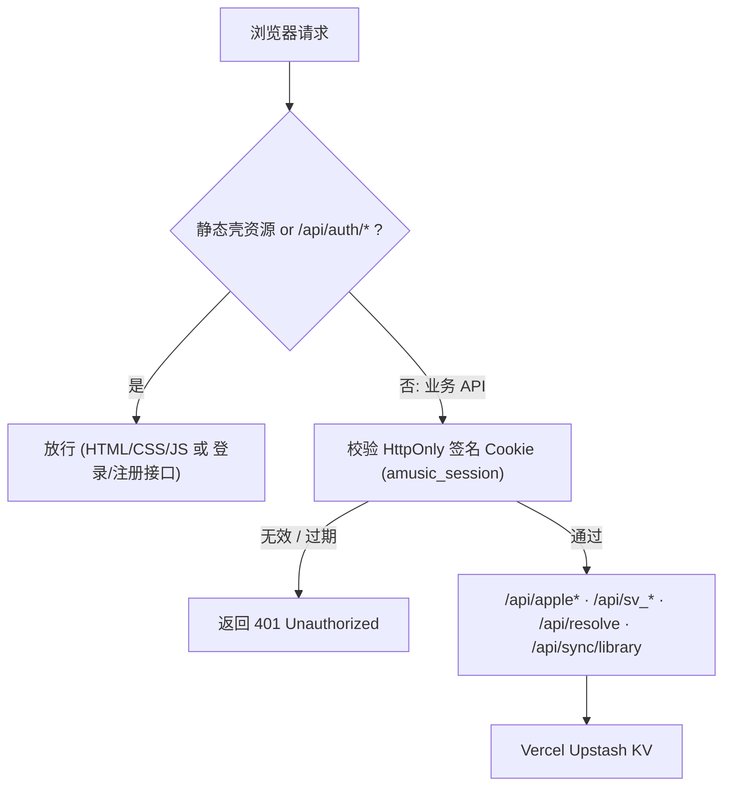

# 🔐 Amusic 邀请码账户门禁与 Vercel KV 歌单云同步架构设计书

> **文档状态**：方案设计稿（已拍板边界，暂未动手实施业务代码）  
> **对齐基准**：沿用 [ARCHITECTURE.md](./ARCHITECTURE.md) 与 [kv_cache.py](./kv_cache.py) 的「零三方依赖纯 Python + Vercel Serverless + 原生前端模块化」原则。

---

## 一、 核心设计边界与已拍板决策

1. **强制登录门禁（听歌必须注册登录，前后端双拦截）**
   - **前端拦截**：未登录状态下打开网站，直接展示全屏登录/注册门禁界面，隐藏/锁定歌单浏览、播放与下载操作。
   - **后端拦截**：所有业务接口均强制校验登录态 Cookie，未登录一律返回 `401 Unauthorized`，杜绝绕过前端界面直接调用接口白嫖 Vercel 与音源资源。
2. **邀请码注册（Vercel 环境变量托管）**
   - 仅开放「邀请码注册」，**不允许无邀请码自由注册**。
   - 邀请码不写死在业务源码中，统一通过 Vercel 环境变量 `AMUSIC_INVITE_CODES` 配置（支持英文逗号分隔多个邀请码）。
   - **初始约定邀请码**：部署时在 Vercel 后台配置 `AMUSIC_INVITE_CODES=1111`；后续若需暂停新用户注册或更换口令，直接在 Vercel 后台修改/删除该环境变量并重新生效即可。
3. **初始数据为 0（不迁移旧本地歌单，云端为单一事实来源）**
   - 新用户注册后，云端歌单资产初始化为空（全部为 `0`）。
   - 登录成功后**直接以云端数据为准**覆盖本地歌单缓存，**不做登录前本地旧歌单自动上传迁移**；退出登录时清理本地歌单缓存，防止同一设备切换账号发生串单。
4. **最小化云同步范围（省 KV 额度）**
   - **仅同步 3 类核心资产**：
     1. 自建歌单（`amusic_custom_playlists`）
     2. 收藏歌单（`amusic_fav_playlists`）
     3. 自定义分组（`amusic_categories_custom`、`amusic_categories_fav`）
   - 音量、最后播放记录（`lastPlaylist`）、SWR 目录缓存、地区偏好等高频/临时状态**继续仅存本地 `localStorage`**，不写入 KV。
   - 歌单增删改触发 **2 秒防抖合并上传**，避免连续操作产生冗余 KV 写入。
5. **顶部栏右侧用户入口**
   - 在顶部导航栏右侧（`.header-right`）增加**当前用户名按钮**（附带同步状态指示），点击可展开操作（手动立即同步 / 退出登录）。
   - 保留现有「我的音乐库」内「↑ 备份歌单 / ↓ 恢复歌单」本地 JSON 导出导入功能，作为额外冷备份手段。

---

## 二、 环境变量配置规范（Vercel Dashboard）

在 Vercel 项目 `Settings -> Environment Variables` 中配置：

| 变量名 | 示例值 / 说明 | 作用 |
| :--- | :--- | :--- |
| `KV_REST_API_URL` / `KV_REST_API_TOKEN` | *(已有 Upstash KV 环境变量)* | 存储用户账号与歌单资产 |
| `AMUSIC_INVITE_CODES` | `1111`（可逗号分隔多个，如 `1111,vip2026`） | 注册邀请码校验白名单 |
| `AMUSIC_AUTH_SECRET` | 32 位以上随机字符串 | `HMAC-SHA256` 签名会话 Cookie 密钥 |

> **本地开发兜底策略**：当非 Vercel 本地调试环境（`os.environ.get("VERCEL")` 为空）且未配置 KV 环境变量时，允许退回到本地被 `.gitignore` 忽略的 `.local_auth.json`（本地默认调试邀请码可设为 `1111`）；一旦运行在 Vercel 生产环境，若缺失 `AMUSIC_AUTH_SECRET` 或 KV 配置则**默认拒绝注册/登录（Fail-Close）**。

---

## 三、 数据结构与 Vercel KV 存储设计

复用 `kv_cache.py` 现有 Upstash REST 连接池（`_execute_kv_command`），**所有账户与歌单键均不设过期时间（永久存储）**。

### 1. 用户账号键：`amusic:auth:user:{username}`
- `{username}`：统一转小写校验（仅允许 `^[a-zA-Z0-9_-]{3,24}$`）。
- 存储 JSON：
  ```json
  {
    "username": "yytak",
    "salt": "32位十六进制随机盐",
    "password_hash": "PBKDF2-HMAC-SHA256(100000轮)十六进制摘要",
    "created_at": 1762840000
  }
  ```

### 2. 用户歌单资产键：`amusic:user:{username}:library`
- 注册时初始写入（全部为 0）：
  ```json
  {
    "customPlaylists": [],
    "favPlaylists": [],
    "categoriesCustom": [],
    "categoriesFav": [],
    "version": 1,
    "updatedAt": 1762840000000
  }
  ```
- **单用户体积保护**：写入前校验序列化 JSON 字节数上限（如 `<= 512 KB`），防止异常膨胀或恶意大报文打满 KV。

---

## 四、 后端接口与鉴权架构



### 1. 新建 `auth_store.py`（纯 Python 标准库）
- **密码安全**：`os.urandom(16)` 随机盐 + `hashlib.pbkdf2_hmac("sha256", pwd.encode("utf-8"), salt_bytes, 100000)`，使用 `hmac.compare_digest` 恒定时间比对。
- **TLS 与 Fail-Close 约定**：涉及账号与云端歌单 KV 读写时使用校验 TLS 证书的 HTTPS 请求（避免沿用全局 `CERT_NONE` 连接池），超时设为 `2.5s~3.0s`；在 Vercel 生产环境下 KV 异常必须明确返回失败，不可静默当成成功。
- **会话签发与校验**：
  - Payload：`{ "u": username, "exp": now + 30 * 86400 }`（30 天免重复登录），Base64URL 编码后拼接 `HMAC-SHA256(payload, AMUSIC_AUTH_SECRET)`。
  - 下发 `Set-Cookie: amusic_session=...; HttpOnly; Path=/; Max-Age=2592000; SameSite=Lax`（HTTPS 环境下附带 `; Secure`）。
- **核心接口函数**：
  - `register_user(username, password, invite_code)`：校验邀请码（比对 `AMUSIC_INVITE_CODES`）➔ 校验用户名不重复 ➔ 写入账号键与初始全 0 歌单资产键。
  - `login_user(username, password)`：校验账号密码 ➔ 签发 Cookie。
  - `verify_session(headers)`：从 `Cookie` 头提取并验签，返回 `username` 或 `None`。
  - `get_user_library(username)` / `save_user_library(username, payload)`：读写 `amusic:user:{username}:library`。

### 2. 修改 `server.py`
- **新增 Auth & Sync 路由**：
  - `GET /api/auth/me`：检查当前登录状态，已登录返回 `{ authenticated: true, username }`；未登录返回 `401`（或 `{ authenticated: false }`）。
  - `POST /api/auth/register`：校验用户名、密码（≥ 6 位）、邀请码 ➔ 创建账号与全 0 初始歌单 ➔ 自动下发登录 Cookie。
  - `POST /api/auth/login`：校验用户名密码 ➔ 下发登录 Cookie。
  - `POST /api/auth/logout`：清除 `amusic_session` Cookie。
  - `GET /api/sync/library`：读取当前登录用户的云端歌单资产。
  - `POST /api/sync/library`：保存当前登录用户的 `customPlaylists`、`favPlaylists`、`categoriesCustom`、`categoriesFav`（与 `vercel.json`、`api/index.py`、`server.py` 现有 `GET, POST, OPTIONS` 方法体系保持完全一致，避免引入 `PUT` 方法不兼容）。
- **全局门禁中间件与缓存隔离**：
  - 在 `do_GET` / `do_POST` 入口，对所有 `/api/*` 请求（除 `/api/auth/login`、`/api/auth/register`、`/api/auth/logout`、`/api/auth/me` 外）统一调用 `verify_session(self.headers)`；未通过直接返回 `401 {"error": "请先登录", "code": "AUTH_REQUIRED"}`。
  - **禁止边缘缓存跨用户串流**：所有受门禁保护的业务接口（包括 `/api/sv_*` 原有的 `public, s-maxage=1800`）必须改为 `Cache-Control: private, no-store`，严防 Vercel CDN 把已登录用户的 200 响应或 401 错误缓存后跨用户下发。
  - 注：允许静态文件（`index.html`、`css/*`、`js/*`、`player.js`）正常返回，以便浏览器展示登录门禁遮罩；未登录前前端 `js/main.js` 不触发任何歌单/目录拉取请求。

---

## 五、 前端门禁与云同步改造蓝图

### 1. 新建 `js/auth.js`（`window.AuthManager`）
- **启动门禁检查**：页面初始化最先调用 `GET /api/auth/me`。
  - **未登录**：挂载全屏登录/注册门禁遮罩（阻止访问主界面），支持切换「登录」与「邀请码注册」（用户名、密码、邀请码输入框），登录/注册成功后拉取云端全量歌单覆盖本地 `localStorage` 并初始化应用。
  - **已登录**：在顶部栏右侧渲染用户名按钮（`👤 {username}`），从 `GET /api/sync/library` 拉取云端最新歌单并写入本地 4 键，再启动 `LeftPanel` / `RightPanel` / `Shell`。
- **防抖自动同步**：
  - 监听 `amusic-storage-changed` 事件，仅当 `key` 属于以下 4 项（或 `restore` 批量恢复事件）时触发 2 秒防抖上传 `POST /api/sync/library`：
    - `amusic_custom_playlists`
    - `amusic_fav_playlists`
    - `amusic_categories_custom`
    - `amusic_categories_fav`
  - 写入本地初始化或同步回填时必须通过 `StorageManager.setJson(..., { silent: true })`（不派发回传事件，仅手动刷新 UI），并在 `importBackup` 中合并为单次 `restore` 事件，防止“拉取云端写入本地”或批量导入触发冗余/死循环上传。
- **退出登录**：
  - 调用 `POST /api/auth/logout` ➔ 清空本地 `amusic_custom_playlists`、`amusic_fav_playlists`、`amusic_categories_custom`、`amusic_categories_fav` 与 `amusic_last_playlist` ➔ 暂停播放并重新弹出全屏登录门禁。

### 2. 修改 `index.html`、`css/base.css`、`js/main.js`、`js/storage.js`
- **`index.html` & `css/base.css`**：
  - 在 `.header-right` 音源 `⚡` 按钮旁新增用户名按钮 `#btnUserAccount`（显示当前用户名与状态图标，点击弹出紧凑账号菜单：立即同步 / 退出登录）。
  - 新增全屏登录/注册门禁遮罩样式（暗色毛玻璃风格与现有弹窗体系一致）。
- **`js/storage.js`**：
  - 暴露只读/静默导入方法（或 `applyCloudLibrary(data)`），在同步回填时更新 4 个键并刷新 `LibraryPanel` 与 `RightPanel`，但不触发反向云端上传。
- **`js/main.js`**：
  - 将原 `DOMContentLoaded` 直接初始化 `LeftPanel` / `Shell` / 恢复 `lastPlaylist` 的逻辑，改为先由 `AuthManager.boot()` 门禁校验通过、同步云端歌单就绪后再执行。
- **全局 401 兜底**：若使用中途 Cookie 失效或被清理，接口返回 `401` 时自动唤起登录门禁。

---

## 六、 实施前确认与验收清单（待后续排期实施）

1. **门禁拦截验收**：
   - 未登录状态下直接访问 `/api/sv_charts`、`/api/apple_new`、`/api/resolve`、`/api/sync/library` 均返回 `401`。
   - 未登录打开网页仅显示登录/注册门禁，无法浏览歌单与播放音乐。
2. **邀请码注册验收**：
   - 错误邀请码（如 `0000`）注册被拒绝；正确邀请码（Vercel 环境变量 `1111`）注册成功并自动登录。
   - 新账号初始自建歌单 = 0、收藏歌单 = 0、自定义分组 = 0（不带入注册前本地旧数据）。
3. **跨设备同步与隔离验收**：
   - 新建自建歌单、收藏官方歌单、新建分组后等待 2 秒，刷新页面或换浏览器登录同一账号，歌单与分组完整同步。
   - 退出登录后切换另一账号登录，前账号歌单不残留、不串单。
   - 顶部栏右侧用户名按钮展示准确，支持手动同步与退出登录。
4. **本地自动化测试兼容**：
   - 实施时需同步更新 `test_headless.js`（启动时自动完成注册/登录前置步骤），保证全站回归测试继续通过。
