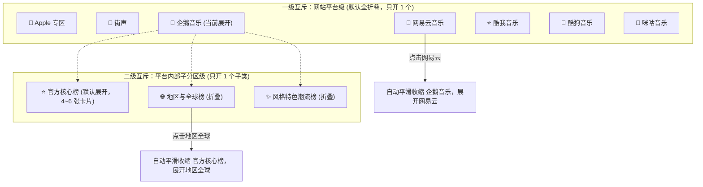
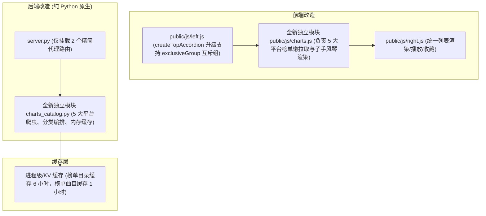

# 🏆 Amusic 国内五大音乐平台榜单专区（企鹅 / 网易 / 酷我 / 酷狗 / 咪咕）扩展架构设计书

> **文档定位**：本功能的设计讨论与技术方案草案，作为开发前与用户讨论制定的单一事实来源（Single Source of Truth）。  
> **对齐基准**：严格沿用 [ARCHITECTURE.md](./ARCHITECTURE.md) 与 [architecture-sv.md](./architecture-sv.md) 确立的「零三方依赖纯 Python + Vercel Serverless + 前端模块化解耦 + 服务端 0 带宽客户端直取」工程原则。

---

## 一、 核心设计理念与第一性原理

1. **统一的操作范式（完全对齐 Apple 专区与街声）**：
   - **完全就地手风琴折叠**：五大平台与既有的「🍎 Apple 专区」和「🎸 街声」同级排列于左侧「网站推荐」面板内，**默认进入时全部折叠**。
   - **极端按需懒加载（Lazy Load）**：未点击展开前，**零网络请求、零 DOM 节点渲染**；只有用户主动点击某个平台手风琴标题时，才触发异步拉取该平台的榜单卡片。
   - **点击榜单直达右侧详情**：点击任意榜单卡片，右侧面板（`RightPanel`）无缝展开榜单歌曲列表，统一支持 `▶` 播放全部、单曲点播、多选操作、`＋` 转存为「我的自建歌单」以及下载。

2. **播放与寻链策略（准而稳，体验闭环）**：
   - 提取榜单曲目元数据严格对齐 Amusic 核心规范：`name`、`artist`、`album`、`durationMillis`、`sourcePlatform`、`platform`、`id`。
   - 直连平台（`tx`、`wy`、`kw` 等）优先透传原始平台与 ID；若遇到会员独占/无版权音频，自动静默无缝进入现有的 `resolver.py` 策略 A（跨源阶梯双核冲刺 + 15s 时长严苛门禁），保障 **曲曲皆可播放**。

---

## 二、 业界通行做法调研与五大平台 API 选型 (GitHub 主流方案)

调研了 GitHub 上主流开源音乐聚合方案（如 `lx-music-desktop`、`NeteaseCloudMusicApi`、`QQMusicApi`、`Meting` 等），提炼出无鉴权、高可用、低延时的官方直连方案：

| 平台 | 榜单列表获取（List API） | 榜单曲目明细（Detail API） | 核心榜单示例 | 播放透传优势 |
| :--- | :--- | :--- | :--- | :--- |
| **🐧 企鹅音乐 (QQ)** | `https://u.y.qq.com/cgi-bin/musicu.fcg` (模块 `music.toplist.ToplistInfoReadServer.GetAll`) | `https://u.y.qq.com/cgi-bin/musicu.fcg` (模块 `musicToplist.ToplistInfoServer.GetDetail`) | 流行指数榜 (4)、热歌榜 (26)、新歌榜 (27)、飙升榜 (62)、抖音热歌榜 (60) | 直连 `tx` 音源，原生音质秒开 |
| **🔴 网易云音乐** | `https://music.163.com/api/toplist` (官方全量榜单元数据，含更新频次) | `https://music.163.com/api/v6/playlist/detail?id={topId}` | 飙升榜 (19723756)、新歌榜 (3779629)、原创榜 (2884035)、热歌榜 (3778678) | 直连 `wy` 音源，曲目库覆盖广 |
| **⭐ 酷我音乐** | `http://kbangserver.kuwo.cn/ksong.s?from=pc&fmt=json&type=bang&data=bang_list` | `http://kbangserver.kuwo.cn/ksong.s?from=pc&fmt=json&type=bang&data=bang&id={id}&pn=0&rn=100` | 酷我飙升榜 (93)、热歌榜 (16)、新歌榜 (17)、抖音热歌榜 (158) | 直连 `kw` 音源，直链解析极快 |
| **🐶 酷狗音乐** | `http://mobilecdnbank.kugou.com/api/v3/rank/list?version=9108&plat=0` | `http://mobilecdnbank.kugou.com/api/v3/rank/song?rankid={id}&page=1&pagesize=100` | 酷狗TOP500 (8888)、飙升榜 (6666)、华语新歌榜 (31308) | 直连 `kg` 或策略 A 秒级补全 |
| **🎵 咪咕音乐** | `https://app.c.nf.migu.cn/MIGUM2.0/v1.0/content/queryconfigdata?tagId=220` | `https://c.musicapp.migu.cn/MIGUM2.0/v1.0/content/index/rank/detail?columnId={id}&needAll=0` | 音乐榜、影视榜、华语榜、欧美榜、尖叫榜 | 直连 `mg` 或策略 A 秒级补全 |

---

## 三、 各大平台官方榜单原生分类与分区方案

五大平台的官方榜单数量确实非常庞大（例如网易云有 65 个榜、酷狗有 55 个榜），若全量堆叠会导致页面无限向下滚动拉得非常长。经查验，各大平台官方在底层 API 和官方界面中**均天生具备清晰的分区分类**。

我们可以完全对齐 Apple 市场（`最新发布` 与 `类别探索`）的设计思想，为每个平台提取出统一的 **「三级分类矩阵」**：

| 平台 | 分区 1: ⭐ 官方核心榜 (默认呈现) | 分区 2: 🌐 地区与全球榜 | 分区 3: ✨ 风格与特色潮流榜 |
| :--- | :--- | :--- | :--- |
| **🐧 企鹅音乐 (QQ)** *(官方 ToplistInfo 原生分组)* | 飙升榜、热歌榜、新歌榜、流行指数榜 | 内地榜、香港地区榜、台湾地区榜、欧美榜、韩国榜、日本榜 | 说唱榜、电音榜、动漫音乐榜、影视金曲榜、腾讯音乐人原创榜、抖音热歌榜 |
| **🔴 网易云音乐** *(官方 toplist 页面原生划分)* | 飙升榜、新歌榜、原创榜、热歌榜（官方招牌四大榜） | 美国Billboard榜、英国UK榜、日本Oricon周榜、Beatport全球电音榜 | 说唱榜、电音榜、古典榜、ACG音乐榜、国风热歌榜、摇滚榜 |
| **⭐ 酷我音乐** *(官方 qukudata 原生分类)* | 酷我飙升榜、酷我新歌榜、酷我热歌榜 | 酷我欧美榜、酷我韩语榜、酷我日剧榜、Billboard榜、英国UK榜 | 抖音热歌榜、网络红歌榜、最强翻唱榜、古风音乐榜、影视金曲榜、电音榜 |
| **🐶 酷狗音乐** *(官方 m.kugou 原生分类)* | 酷狗TOP500、飙升榜、华语新歌榜 | 欧美新歌榜、粤语新歌榜、日韩新歌榜、香港新歌榜 | 抖音热歌榜、快手热歌榜、DJ热歌榜、国风新歌榜、网络红歌榜 |
| **🎵 咪咕音乐** *(官方 MIGUM 原生分类)* | 音乐榜、尖叫榜、热歌榜、新歌榜 | 华语榜、欧美榜、日韩榜、粤语榜 | 影视金曲榜、国风榜、摇滚榜、民谣榜、电音榜、彩铃榜 |

---

## 四、 左侧栏「双层全局互斥手风琴」交互架构 (Exclusive Accordions)

根据讨论敲定，采用 **「形态 B 纵向分段流 + 双层全局互斥折叠」** 核心交互机制，彻底解决左侧栏条目膨胀与长列表拖拽疲劳：

### 1. 一级平台互斥（Website Level Exclusive Accordion）
* 在左侧「网站推荐」面板内，7 大平台（Apple、街声、企鹅、网易、酷我、酷狗、咪咕）归属于同一个互斥组（`exclusiveGroup: "website"`）；
* **行为规则**：
  * 进入页面时，所有平台默认全部折叠收起；
  * 当用户点击展开任意一个平台（例如 `企鹅音乐`）时，之前若有任何其他已展开的平台（如 `Apple专区` 或 `网易云`），系统会**自动将其平滑收缩闭合**；
  * **单一事实保障**：左侧栏纵向在任何时刻最多只有 1 个平台处于展开状态，屏幕空间始终充裕。

### 2. 二级子类互斥（Category Level Exclusive Accordion）
* 展开某个平台后，其内部划分为 3 个子类手风琴折叠块：
  1. `⭐ 官方核心榜`（首次进入该平台时默认展开，展示 4~6 张核心大榜，如飙升、热歌、新歌）
  2. `🌐 地区与全球榜`（默认折叠）
  3. `✨ 风格特色潮流榜`（默认折叠）
* **行为规则**：
  * 这 3 个子类同属一个平台级互斥组（如 `exclusiveGroup: "qq_sub"`）；
  * 当用户在企鹅音乐内点击展开 `🌐 地区与全球榜` 时，原本展开的 `⭐ 官方核心榜` **自动平滑折叠收缩**；
  * **黄金浏览高度**：无论用户怎么点开，内部永远只展示当前这一个子分类的卡片网格，**高度牢牢锁定在 1~1.5 屏之内**，彻底终结瀑布流长滚痛点。

---

## 五、 模块拆分与工程落地规划

### 1. 前端模块职责
* **`public/js/left.js`**：
  * 对现有 `createTopAccordion` 增强 10 行代码：增加 `exclusiveGroup` 参数与组内广播机制，开 A 则平滑收起同组内的 B/C/D；
  * 在 `viewApple`（网站推荐）中以循环/配置方式依次挂载企鹅、网易、酷我、酷狗、咪咕 5 大手风琴。
* **`public/js/charts.js` (全新独立文件，命名空间 `window.ChartsPanel`)**：
  * 对齐 `streetvoice.js` 与 `region.js`，承载五大平台榜单卡片的异步拉取与二级互斥子手风琴创建；
  * 点击榜单卡片，通过 `window.RightPanel.selectChartsPlaylist(platform, id, title, coverUrl)` 直通右侧详情。
* **`public/js/right.js`**：
  * 暴露 `selectChartsPlaylist`，统一调用 `/api/charts/detail` 获取曲目并加载到右侧，享受一键 `▶` 播放、单曲点播与 `＋` 转存自建歌单全部既有能力。

### 2. 后端模块职责
* **`charts_catalog.py` (全新独立文件)**：
  * 集中承载 5 大平台的接口请求、数据解析与分类清洗；
  * 统一标准化输出格式：
    * 榜单目录：`{ ok: true, platform: "qq", categories: [ { name: "官方核心榜", key: "core", lists: [...] }, ... ] }`
    * 榜单明细：严格对齐 Amusic 曲目标准（`name`, `artist`, `album`, `durationMillis`, `sourcePlatform`, `platform`, `id`）。
* **`server.py`**：
  * 仅增挂 10 行代理路由：`GET /api/charts/list` 与 `GET /api/charts/detail`，零污染既有代码。

---

## 六、 讨论敲定的核心技术决策（单一事实来源）

通过深度讨论，针对 5 大关键设计全面达成共识并敲定如下准则：

| 决策点 | 敲定方案 | 详细实施规范 |
| :--- | :--- | :--- |
| **1. 收藏与动态更新** | **左侧官方榜单存为 `favPlaylists`（动态收藏）** | • 外部粘贴链接导入：存入 `customPlaylists`（自建歌单静态快照，不随原平台变动）； • **左侧 5 大官方榜单点 `＋` 收藏**：统一存入 **`favPlaylists`（收藏歌单）**，保留统一命名空间 ID（如 `chart_wy_19723756`、`chart_tx_26`）。每次从「我的音乐库 ➔ 收藏的歌单」中打开，**自动拉取最新期榜单曲目，实现自动更新**！ |
| **2. 曲目容量与分页** | **全局默认最多 100 首，底部「加载更多」** | • 所有榜单首次默认加载前 **100 首（Top 100）**，保障毫秒级加载与 0 超时风险； • 若榜单总数超过 100 首（如酷狗 TOP500），曲目列表底部展示轻量「加载更多 (剩余 XX 首)」按钮，用户点击后再拉取/展示后续曲目； • **该规则作用于全局**。 |
| **3. 刷新页面记忆** | **策略 A：纯净默认全收起** | • 用户每次打开或刷新页面，左侧「网站推荐」内的 7 个平台手风琴**默认全部保持折叠闭合（清爽 7 行）**； • 不在本地持久化复杂的展开状态，保持首屏零冗余计算与极致轻快。 |
| **4. VIP 歌曲寻链兜底** | **直连音源优先 + 100% 策略 A 跨源保底** | • 榜单曲目优先携带所属平台直连音源 ID； • 若因原平台 VIP 独占/403/试听片段导致播放受阻，播放器底层 **100% 自动降级走策略 A（全网跨源阶梯双核冲刺 + 15s 门禁）**，自动从酷我/咪咕等渠道无损秒级补齐，保证 **榜单歌曲曲曲皆可播放**。 |
| **5. 服务端缓存周期** | **低压长效缓存（最快 12 小时）** | • **榜单目录结构**：内存/KV 缓存 **24 小时**； • **榜单曲目列表**：内存/KV 缓存 **12 小时**（与各大平台发榜节奏高度契合，最大程度降低上游并发压力与风控风险）。 |

---

## 七、 实施就绪状态

本规范已完成全部设计决策闭环，所有边界、数据流、异常兜底与交互行为已完全敲定，后续编码严格以本规范为单一事实来源（Single Source of Truth）执行。

