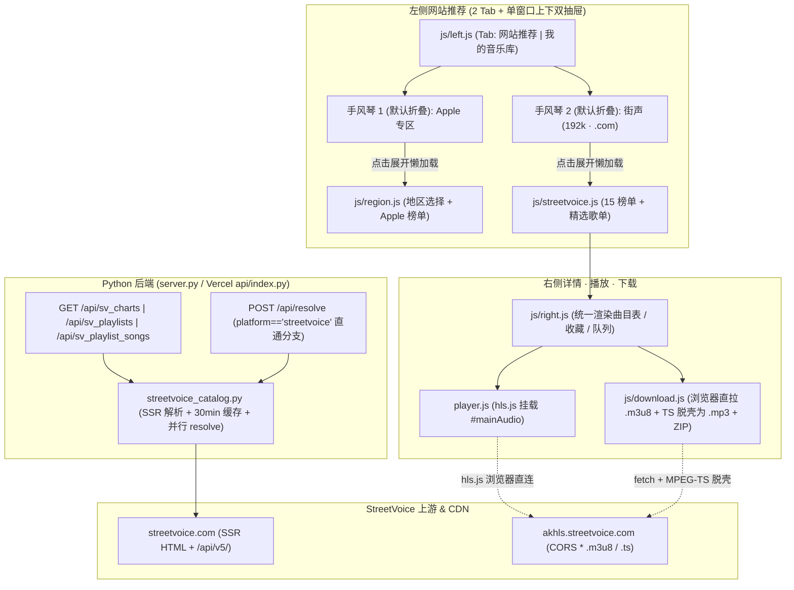

# 🎸 Amusic 街声专区（StreetVoice）扩展架构设计书

> **文档状态**：已合并至 `master` 上线运行  
> **对齐基准**：沿用 [ARCHITECTURE.md](./ARCHITECTURE.md) 的「零三方依赖纯 Python + Vercel Serverless + 原生前端模块化 + 服务端 0 带宽客户端直取」设计哲学。

---

## 一、 核心设计边界与已拍板决策

1. **左栏入口布局（保持 2 栏 Tab + 单窗口上下双抽屉）**
   - 保留顶部 2 栏 Tab 结构，将原 `Apple专区 | 我的音乐库` 升级为 **`网站推荐 | 我的音乐库`**（不改 50/50 顶部视觉比例与窄屏触控面积）。
   - 点入 **`网站推荐`** 后，在同一滚动窗口内垂直排列两个一级手风琴折叠区，**默认进入时全部折叠，点击才展开加载**：
     1. **`🍎 Apple 专区`**（默认折叠；首次点击展开后才触发 `window.RegionPanel` 懒加载；展开后首行保持现有「🌐 Apple 市场 + 地区选择器」工具栏，下方为 `最新发布` 与 `类别探索`）。
     2. **`🎸 街声`**（默认折叠，标题右侧展示只读 `192k · .com` 标识；首次点击展开后才渲染 `window.StreetVoicePanel`）。
2. **全局搜索框（保持纯 Apple）**
   - 顶部全局搜索框及 `js/search.js` **不接入街声**，继续只检索 Apple Music 曲库。
3. **街声专区内容范围（「15 个官方排行榜 + 精选歌单广场」）**
   - **官方排行榜（15 榜 × Top 50）**：即时排行（8 个分类）+ 每周排行（7 个分类），1 套 HTML 解析器通吃全部榜单页面。
   - **精选歌单广场（600+ 歌单）**：精选总览（`/music/playlists/all/most_liked/`，63 个精选）+ 7 大官方主题分区（`/music/playlist/section/{section}/`）；点开具体歌单后直接调用纯 JSON 接口拉曲目。
   - 暂不抓取 22 个曲风的无限瀑布流投稿池（未来如有需要，可直接在 `streetvoice_catalog.py` 平滑追加函数，无返工）。
4. **音频播放与下载闭环**
   - **绝不走“策略 A 跨源寻链”**：街声独立音乐在酷我/QQ/网易曲库大概率无源或错配，点播时携带 `platform: "streetvoice"` 与街声 `song_id`，直通街声官方 HLS 流与原生歌词。
   - **播放**：引入 `hls.js`（Safari 走原生 `<audio>` HLS）。
   - **下载**：利用街声 CDN 开放 `CORS *` 且 `.ts` 内封装**未加密原生 MP3 帧**的特性，在浏览器端实现纯 JS MPEG-TS 脱壳，**单曲下载与 ZIP 批量打包均直接输出标准 `.mp3` 文件**，Vercel 服务端零带宽消耗。
5. **域名与降级策略（Vercel 部署）**
   - 默认使用 **`streetvoice.com`**（海外 Vercel 节点直连快、提供 **192kbps** HLS、繁体元数据）。
   - `街声` 手风琴标题栏右侧仅展示只读音质/线路标识（如 `192k · .com`），**不开放手动切换按钮**；仅当 `.com` 解析失败时，由后端自动降级重试 **`streetvoice.cn`**（**96kbps** HLS），并在 `source_name` 中如实回显。
6. **收藏、自建歌单与历史恢复隔离**
   - 街声「15 个官方榜单」与「精选歌单」均支持收藏进「我的音乐库」及记忆为最后访问歌单（`lastPlaylist`）；街声单曲加入自建歌单时完整持久化 `platform: "streetvoice"`，避免刷新后回放误走 Apple 跨源检索，且与 Apple 纯数字专辑 ID 做好命名空间隔离。
7. **音源健康度监控（`⚡` 面板）**
   - 街声官方直连通道在顶部 `⚡` 底层音源监控面板中**置顶放第 1 行**，由真实连通性探针返回实测延迟与健康状态；不混入 Apple 用的 `source_manager.py` 跨源寻链排序池，两者互不干扰。

---

## 二、 街声官方接口与页面契约（实测已验证）

| 能力 | 请求方式与地址 | 返回形态 | 关键实测结论 |
| :--- | :--- | :--- | :--- |
| **即时排行榜（8 榜）** | `GET https://streetvoice.com/api/v5/chart/realtime/{cat}/?limit=50` | **纯 JSON** | `cat` ∈ `all`, `rock`, `folk`, `hip_hop`, `urban`, `electronic`, `explore`, `ai_generated`；每榜固定 50 首，自带 `song.id`、`name`、`length`（真实时长）、`image`、`user.profile.nickname`（SSR HTML 作兜底）。 |
| **每周排行榜（7 榜）** | `GET https://streetvoice.com/api/v5/chart/weekly/{cat}/?limit=50` | **纯 JSON** | `cat` ∈ `all`, `rock`, `folk`, `hip_hop`, `urban`, `electronic`, `explore`；每榜固定 50 首，共用同一套纯 JSON 映射与真实时长提取。 |
| **精选歌单广场** | `GET https://streetvoice.com/music/playlists/all/most_liked/` | SSR HTML | 单页返回 63 个精选歌单卡片（含 `playlist_id`、名称、封面、创建者）及 7 个主题分区入口。 |
| **歌单主题分区** | `GET https://streetvoice.com/music/playlist/section/{sec}/` | SSR HTML | `sec` ∈ `1`, `chillouttree`, `DJ`, `campus`, `2style`, `situation`, `7`（合计 600+ 歌单，共用歌单卡片解析逻辑）。 |
| **歌单曲目明细** | `GET https://streetvoice.com/api/v5/playlist/{id}/songs/?limit=100` | **纯 JSON** | 无需爬 HTML；直接返回 `results[].song`（含 `id`, `name`, `length`, `image`, `user.profile.nickname`）。 |
| **单曲详情与歌词** | `GET https://streetvoice.com/api/v5/song/{id}/` | **纯 JSON** | 返回 `name`, `length`, `image`, `lyrics`, `lyrics_is_lrc`, `user.profile.nickname` 等。 |
| **音频播放流** | `POST https://streetvoice.com/api/v5/song/{id}/hls/file/` | **纯 JSON** | `.com` 返回 `https://akhls.streetvoice.com/...192khls.mp3.m3u8`；`.cn` 返回 `...96khls.mp3.m3u8`（注：`/file/` 直链返回 `403`）。 |
| **CDN 分片传输** | `GET https://akhls.streetvoice.com/.../*.ts` | 二进制 TS | **无加密**（无 `#EXT-X-KEY`）；**全开 `access-control-allow-origin: *`**；PES `stream_id=0xc0` 内直接为原生 **MP3 帧（`0xFF 0xFB`）**。 |

> **注意**：`streetvoice.com/api/v5/...` 元数据与流解析接口本身不返回 CORS 头，必须经由 `Amusic` Python 后端代理；而拿到的 `.m3u8` 与 `.ts` CDN 资源则允许浏览器端直接跨域拉取。

---

## 三、 系统架构与数据流图

---

## 四、 模块与文件级改造蓝图

### 1. 后端模块（纯 Python 标准库 + `urllib3`，零新增依赖）

#### 1.1 新建 `streetvoice_catalog.py`
参照 `apple_catalog.py` 的结构，内置 30 分钟二级内存缓存（`_SV_CACHE` + 锁 + LRU 淘汰）：
- **常量定义**：
  - `SV_CHART_DEFINITIONS`：静态枚举 8 个即时榜 + 7 个周榜的 `id`、中文标题、子路径 `realtime/{cat}/` 或 `weekly/{cat}/`。
  - `SV_PLAYLIST_SECTIONS`：静态枚举精选总览 + 7 个官方主题分区的中文名称与路径。
- **核心函数**：
  - `fetch_sv_chart(kind, category, host="com")`：优先直连 `/api/v5/chart/{kind}/{category}/?limit=50` 纯 JSON 提取 50 首曲目与真实时长 `durationMillis = length * 1000`（SSR HTML 解析仅作降级兜底）。
  - `fetch_sv_playlists(section="all", host="com")`：抓取歌单广场或指定主题分区的歌单卡片列表（`id`, `type="playlist"`, `title`, `curator`, `cover`, `url`）。
  - `fetch_sv_playlist_songs(playlist_id, host="com")`：调用 `/api/v5/playlist/{id}/songs/?limit=100`（如有需要支持 `offset` 翻页），映射为前端统一的曲目结构（含 `durationMillis = length * 1000`）。
  - `resolve_streetvoice_track(song_id, host="com")`：
    - 使用 `ThreadPoolExecutor(max_workers=2)` **并行请求** `POST /api/v5/song/{id}/hls/file/` 与 `GET /api/v5/song/{id}/`（将单曲解析耗时压至 ~1s 内，避免串行阻塞）。
    - 解析 `lyrics`（同时支持 `lyrics_is_lrc == True` 的时间轴格式，以及无时间轴纯文本歌词兜底）。
    - 返回与 `/api/resolve` 兼容的结构：`{ success: True, url: m3u8_url, is_hls: True, bitrate: "192k" | "96k", source_id: "streetvoice", source_name: "街声 StreetVoice (192k)", bytes: 0, lyrics: [...] }`。
    - 若 `.com` 请求失败，自动降级重试 `.cn`（96k）。
  - `probe_sv_health()`：对街声官方接口做真实轻量连通性探针（含短效缓存），返回实测 `latency_ms` 与 `status`，供顶部 `⚡` 音源监控展示。

#### 1.2 修改 `server.py`（`api/index.py` 自动继承）
- **新增 GET 路由**（对齐 Apple 专区，统一输出 `ETag` 与 `Cache-Control` 缓存头以适配 Vercel Edge 与前端 `swrFetch`）：
  - `GET /api/sv_charts`：不带参数时直接返回静态榜单目录清单（0 网络延迟）；带 `kind` & `category` 时返回对应榜单 Top 50 曲目。
  - `GET /api/sv_playlists?section=all`：返回歌单列表。
  - `GET /api/sv_playlist_songs?id={playlist_id}`：返回歌单曲目明细。
- **扩展 `/api/sources`（含 `/api/sources/test` 与 `/api/sources/sync`）**：
  - 在返回的 `sources` 列表**第 1 行**前置插入「街声官方直连通道」实测健康度卡片（仅用于面板状态展示，不混入 Apple 的 `source_manager.py` 跨源寻链排序池）。
- **扩展 `POST /api/resolve`**（在现有 `if cand.get("platform") and cand.get("id"):` 分支内）：
  - 当 `cand.get("platform") == "streetvoice"` 时，直接调用 `resolve_streetvoice_track(cand["id"])` 并返回 JSON，**绕过 `source_manager.py` 的 1.2MB 单文件魔数嗅探**（`.m3u8` 为文本清单，不适用字节门槛）。
- **SSRF 安全防御**：若后续有任何代理路径接收外部 URL，白名单补充 `streetvoice.com`、`streetvoice.cn`、`akhls.streetvoice.com`、`hls.streetvoice.cn`。

---

### 2. 前端目录与交互模块

#### 2.1 新建 `js/streetvoice.js`（`window.StreetVoicePanel`）
与 `js/region.js` 保持同一规范（IIFE 模块 + `swrFetch` 缓存 + 懒加载）：
- **两个手风琴分组**：
  1. **官方排行榜**（默认展开）：直接零延迟渲染 8 个即时榜 + 7 个周榜卡片（按即时/周榜分组或标签区分）。
  2. **精选歌单**（折叠按需加载）：展开后渲染「精选推荐（63 部）」及 7 个主题分区二级折叠，支持按需懒加载歌单卡片。
- **右侧联动**：
  - 点击榜单卡片 ➔ 拉取 `/api/sv_charts?kind=...&category=...`，调用 `window.RightPanel` 展示榜单曲目（每首自带 `platform: "streetvoice"`、`id`）。
  - 点击歌单卡片 ➔ 拉取 `/api/sv_playlist_songs?id=...`，调用 `window.RightPanel` 展示歌单曲目。

#### 2.2 修改 `js/left.js`、`js/region.js` & `css/left.css`
- 将 `tabsNav` 第 1 个 Tab 文案从 `Apple专区` 调整为 `网站推荐`（保留原有 `tabAppleCol` / `tabAppleBtn` 等 ID 兼容钩子，并同步更新 `test_headless.js` 中的标题断言）。
- 在第 1 栏视图（`#viewApple`）内垂直装配两个一级手风琴块（使用现有 `createTopAccordion` 样式规范），**默认均处于折叠状态**：
  1. **`Apple 专区` 手风琴**：展开体内部首行放置现有的「🌐 Apple 市场 + 地区选择器」工具栏与 `#appleContent`；仅当用户首次点击展开 `Apple 专区` 时，才触发 `RegionPanel` 懒加载首屏数据（避免进入页面即发起无效请求）。
  2. **`街声` 手风琴**：标题栏右侧带只读 `192k · .com` 徽标，展开体内部挂载 `#svContent`（`StreetVoicePanel`）；仅当用户首次点击展开 `街声` 时再初始化并加载内容。
- 顶部全局搜索框（`js/search.js`）**不做任何街声接入**；右侧表格内点击街声曲目的歌手/专辑名时，仍沿用现有逻辑跳转 Apple 搜索框检索。
- 同步调整 `createPlaylistCard` 与 `openItem`：识别 `platform: "streetvoice"`（区分榜单 `svType: "chart"` 与歌单 `svType: "playlist"`），防止纯数字街声歌单 ID 被误判为 Apple 专辑。

#### 2.3 修改 `js/right.js`、`js/storage.js` 与 `js/main.js`
- `js/right.js`：新增街声榜单/歌单加载方法（如 `selectSvChart` / `selectSvPlaylist`）；渲染曲目传给 `player.playTracklist`、`StorageManager` 及 `Downloader` 时完整保留 `platform: "streetvoice"` 与街声 `id`。点击收藏 `＋` 时携带 `platform: "streetvoice"` 与 `svType`。
- `js/storage.js`：`addTrackToCustomPlaylist` 持久化保存 `platform` 字段；收藏歌单及 `isPlaylistFaved` 对街声使用独立前缀/平台标识（兼容历史 Apple 备份 JSON 不冲突）。
- `js/main.js`：页面启动恢复 `lastPlaylist` 时支持街声榜单与街声歌单分支。

---

### 3. 播放引擎与客户端真 MP3 下载

#### 3.1 修改 `index.html`
- 引入 `hls.min.js`（CDN 版本锁定：`https://cdn.jsdelivr.net/npm/hls.js@1/dist/hls.min.js`）与 `js/streetvoice.js`。
- **升级所有受影响静态资源 `?v=` 查询参数**（`vercel.json` 对 `js/*`、`css/*`、`player.js` 配有 `max-age=86400` 强缓存，必须同步递增版本号破除浏览器旧缓存）。

#### 3.2 修改 `player.js`
1. **统一音频源挂载器 `_setAudioSource(url)`**：
   - 在 `playIndex` 切歌暂停前及每次 `_setAudioSource` 切换前，立即停止并销毁上一次的 `this.hlsInstance`（防止快速从街声切回 Apple 时后台继续拉流或双声叠加）。
   - 将 `player.js` 中**全部 3 处**直接赋值 `this.audio.src = ...` 的路径（缓存命中秒开、正常解析播放、出错自愈重解析）全部收口到 `_setAudioSource(url)`。
   - 若 `url` 包含 `.m3u8`：
     - 优先使用 `window.Hls && window.Hls.isSupported()` 创建 `Hls` 实例，`loadSource(url)` + `attachMedia(this.audio)`；监听 `Hls.Events.ERROR`（遇到 `fatal` 网络/媒体错误时触发重解析或顺延兜底）。
     - 若处于 Safari / iOS 且 `this.audio.canPlayType('application/vnd.apple.mpegurl')` 为真，直接 `this.audio.src = url`。
   - 普通直链（酷我/网易/代理流）：直接走原 `this.audio.src = url`。
2. **关键避坑：修复预加载、错误降级、封面与歌词兜底**：
   - `_preloadAudioBuffer(key, url)`：若 `url.includes('.m3u8')`，**直接跳过 `this.preloadAudio.src = url`**（否则 Chrome 原生 `<audio>` 会因不认 `.m3u8` 立即触发 `error` 事件，导致刚刚缓存的解析结果被错误删除）。`.m3u8` 仅保留在 `resolveCache` 中实现秒切即可。
   - `_handleStreamFallback(...)`：对 `.m3u8` 链接不要盲目套 `/api/stream_proxy?url=...`（因为 `.m3u8` 内部是相对路径的 `.ts` 分片，代理清单本身会导致相对路径变更为 `/api/*.ts` 而 404）。若街声曲目无可用 HLS 流或加载失败，直接提示不可播并顺延下一首，不走跨源寻链。
   - `_getSongKey(song)`：将 `streetvoice` 纳入平台白名单，避免街声曲目缓存与 Apple 同名曲目碰撞。
   - `playTracklist` / `setPlaylist`：补全保留 `cover` / `artwork` 与 `url` 字段，确保锁屏 MediaSession 能正常展示街声封面。
   - 无歌词防串台：对 `platform === "streetvoice"` 且 `resolve` 已明确返回空歌词的曲目，不再二次调用 `/api/lyric` 去国内曲库误搜同名歌词。
3. **纯文本歌词适配**：
   - 街声部分歌曲歌词不带 `[mm:ss.xx]` 时间戳（`lyrics_is_lrc: false`）：标记 `untimed: true`，`_syncLyrics` 识别后停留在首行、关闭随进度自动跳至末行；歌词栏仍保留原有的松手回弹与展开/拖拽/长按复制交互。

#### 3.3 修改 `js/download.js`
1. **`resolveTrackAudioUrl(track)` 补全字段**：
   - 请求 `/api/resolve` 时透传 `id: track.id || ""` 与 `platform: track.platform || ""`，同时返回 `is_hls: !!data.is_hls`。
   - 对 `is_hls` 曲目在单曲下载失败时**禁用 `a.href = res.url` 降级**（防止浏览器直接保存出几百字节的 `.m3u8` 文本假 MP3）。
2. **纯 JS MPEG-TS 脱壳器 `demuxMpegTsToMp3(tsUint8Array)`（约 40 行）**：
   - 浏览器端检测 `url.includes('.m3u8')` 或 `res.is_hls` 时：
     1. `fetch(m3u8Url)` 获取文本清单，解析出所有分片 URL（以 `new URL(line, m3u8Url).href` 拼接绝对地址）。
     2. 并发 `fetch`（例如并发 4~6）拉取所有 `.ts` 分片为 `Uint8Array`。
     3. 逐个按 **188 字节** 步长扫描 `0x47` 同步包：
        - 跳过 Adaptation Field（`afc === 2 || afc === 3` 时读取自适应区长度）；
        - 检查 `PUSI`（Payload Unit Start Indicator）定位 PES 头 `0x00 0x00 0x01`，过滤音频流 `0xC0 <= stream_id <= 0xDF`，跳过 PES 可选头长度（`9 + pesHeaderDataLength`）；
        - 将该音频 PID 后续连续包的有效载荷拼接起来，即为**无损原声 `.mp3` 字节流**。
     4. 直接交由现有的 `triggerDownloadBlob`（单曲保存为 `歌曲 - 歌手.mp3`）或 `createZip`（多选批量打包 ZIP）。

---

## 五、 上线前验收清单（实施后必测项）

1. **后端接口与 Vercel 超时检查**
   - `GET /api/sv_charts`（列表秒回）及随机抽查 3 个榜单（`realtime/all`、`weekly/rock`、`weekly/folk`）均返回 50 首有效曲目。
   - `GET /api/sv_playlists` 与 `GET /api/sv_playlist_songs?id=857174` 返回完整歌单曲目。
   - `POST /api/resolve`（传 `{ platform: "streetvoice", id: "123688" }`）在 2 秒内返回有效 `.m3u8` 与歌词。
   - `GET /api/sources` 与顶部 `⚡` 音源监控面板第 1 行展示「街声官方直连通道」实测延迟与状态，且不影响 Apple 音源池排序。
2. **播放器状态机检查**
   - Chrome / Edge 播放街声歌曲（`Hls` 实例）正常出声、进度条拖拽正常、歌词同步/展示正常（纯文本无时间戳歌词停在首行，保留手动拖拽与长按复制）。
   - **混播切换回归**：从街声 `.m3u8` 切到 Apple（酷我/网易 `.mp3`/`.flac`），再切回街声，确认无双声叠加、无 `preloadAudio` 误删缓存。
   - 切歌期间收藏歌曲/歌单到“我的音乐库”，刷新页面重新播放自建歌单或恢复记忆歌单里的街声内容仍可直通出声。
3. **下载回归检查**
   - 街声单曲下载：保存出的 `.mp3` 文件可被系统原生播放器/VLC 正常打开播放，时长完整、无杂音。
   - 混合批量 ZIP 下载：同时勾选 2 首 Apple 歌曲 + 2 首街声歌曲打包 ZIP，解压后 4 个 `.mp3` 均可正常播放，服务端零额外流量。
4. **左栏布局与 Apple 原有功能无回归**
   - `网站推荐` 页签进入时 `Apple 专区` 与 `街声` 均默认折叠、点击才展开加载；同步更新 `test_headless.js` 标题断言并通过回归。
   - 顶部全局搜索框只搜 Apple Music（点击街声表格歌手/专辑名可跳转 Apple 搜索）；Apple 地区切换（国区/港区/美区等）与榜单加载正常。
